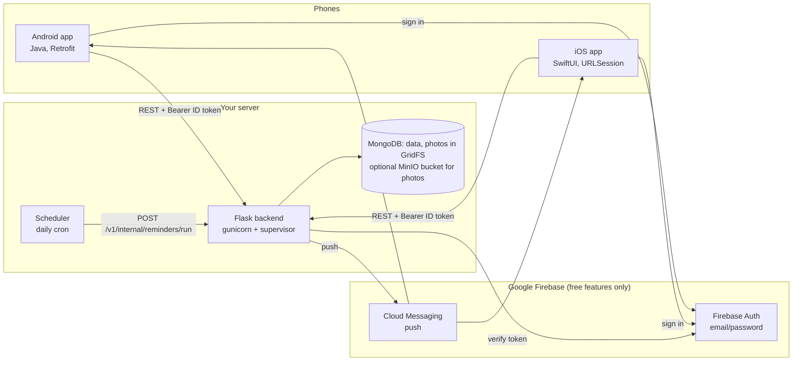
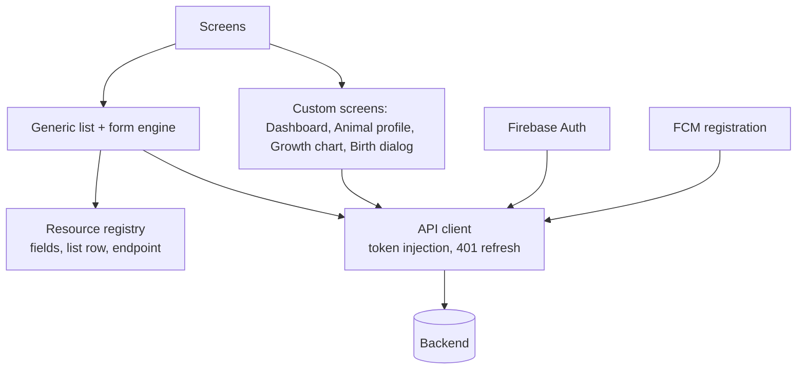

# Architecture

## 1. Big picture



Principles:
- **Thin clients, smart server.** The apps hold no business rules beyond input forms; the server validates everything, computes ages, expected birth dates, reminders, dashboard totals and reports.
- **One source of truth:** MongoDB. Firebase provides identity and push delivery only.
- **Private by construction:** every record lives under a farm; every request is resolved to the caller's farm from their verified token. There is no farm id in any URL, so a user cannot address another farm's data.

## 2. Backend (`farmivo_backend`)

```
app/
  main.py            Flask app factory create_app(), blueprints, /healthz, ProxyFix (scheme and host behind nginx);
                     exposes `app` for gunicorn
  config.py          Settings from FARMIVO_* env vars and .env (DB backend, Mongo, photo store, Mailjet, breed photos dir)
  deps.py            Wiring: Firebase init, repository/photo store selection (tests inject fakes via
                     create_app(overrides=...)), get_identity (verifies the ID token), get_ctx (active membership -> farm + role)
  permissions.py     Roles (owner, manager, worker, viewer) and what each may do, checked in get_ctx
  errors.py          ApiError + JSON error handlers ({"detail": ...}; 422 lists also get a readable "message")
  i18n.py            English / French / Arabic: message catalog, translation of every error and server text
                     (Accept-Language), field and species words, durations ("5 أشهر و10 أيام")
  web.py             Request/response helpers: body(model) -> 422 on bad input, out(...), query-string parsers
  repository.py      Storage abstraction: MongoRepository (default), FirestoreRepository, InMemoryRepository (tests)
  schemas.py         Pydantic models = the API contract and all validation rules
  utils.py           Dates, ages, gestation table
  -- business rules (pure functions over the repository, no Flask) --
  animal_codes.py    Farm number of each animal: <species code>-<number>/<year> (01-0007/26)
  age_classes.py     Age by teeth when the date of birth is unknown
  breeds.py          Breed lists per species (Tunisian / Maghreb breeds first), labels in 3 languages
  breed_photos.py    Real breed photos on the server (Wikimedia Commons, downloaded by scripts/fetch_breed_photos.py)
  breeding_rules.py  What is biologically possible: mating ages, pregnancy length, litter size, miscarriage window
  costs.py           What each animal cost (purchase + its share of expenses, feed weighted by age) and the herd's
                     balance sheet ("bilan": capital, expenses, sales, herd value, real profit)
  sales.py           Sales of several animals in one finance entry: the animals leave the farm, each at the average price
  legal.py           Texts of the public pages (privacy, terms, support, account deletion)
  routers/
    crud.py          Generic CRUD blueprint factory (list/get/create/patch/delete + hooks, newest first)
    animals.py       Animals, farm numbers, status changes (sold, dead, given ... and undo), photo upload, family tree,
                     costs, barn capacity reminder, delete cascade
    barns.py         Barns (species allowed, capacity), age classes, breeds and breed photos (/breeds/photo/... public)
    health.py        Vaccinations, treatments, vet visits, illnesses, reminders endpoints
    breeding.py      Matings, pregnancy, miscarriage, birth recording (creates offspring), breeding rules checks
    growth.py        Weights, production, feeding, growth stats, production summary
    finance.py       Transactions (shared by animals, per barn filter, sales), finance summary, balance sheet
    dashboard.py     Aggregated home screen payload
    members.py       Me, onboarding (create farm with its currency / join with invite code), members and roles
    farm.py          Farm settings, device (FCM token) registration
    notifications.py In-app notifications, read/unread
    reports.py       JSON/CSV reports
    photos.py        Serves animal photos stored in MongoDB (public, unguessable id)
    auth.py          "Forgot password?"
    legal.py         Public web pages /privacy, /terms, /support, /delete-account
    internal.py      Cron-only endpoint that sends due-reminder pushes
  services/
    reminders.py     Reminder sync + daily notification run
    notifier.py      FcmNotifier (prod) / NullNotifier (tests)
    photos.py        GridFsPhotoStore (default), MinioPhotoStore, FirebasePhotoStore, MemoryPhotoStore
    membership.py    Who belongs to which farm, join requests and approvals
    verification.py  6-digit email code after sign-up (Mailjet, services/mailer.py)
    password_reset.py, account.py   Password reset email, account deletion
  admin/             Admin web dashboard (/admin, read-only except deleting a farm; docs/ADMIN.md)
scripts/             Server tools: check_setup, seed_demo, delete_farm, migrate_docs, fetch_breed_photos and the
                     one-off release upgrades (upgrade_2026_11_14, upgrade_2026_11_16, sync_breeding_reminders)
tests/               pytest suite, runs on the in-memory repository (no database needed)
```

### Request lifecycle
1. App sends `Authorization: Bearer <Firebase ID token>`.
2. `get_current_uid` verifies the token with Firebase Admin → `uid`.
3. `get_ctx` loads `users/{uid}` and the member record; without an active membership it answers `403` (`no_farm`, `pending` or `rejected`), otherwise it checks the role for this route (`app/permissions.py`, `403 forbidden_role`). Result: `Ctx(uid, farm_id, repo, role, farm)`. Farms are created only by `POST /v1/farms`.
4. The blueprint view reads/writes only `farms/{farm_id}/<collection>` through the `Repository` interface.
5. Pydantic validates input (unknown fields rejected → `422`) and shapes output.

### Repository pattern
All data access goes through six methods (`get`, `list`, `create`, `update`, `set`, `delete`) addressed by Firestore-style paths such as `farms/{farm_id}/animals`. Equality filters are pushed to the database; range filters, sorting and limits run in Python (a single farm has at most a few thousand documents per collection). This keeps the project free of index management and makes the database swappable (see DECISIONS.md).

### Generic CRUD factory
Most record types (vaccinations, treatments, vet visits, illnesses, breedings, weights, production, feedings, transactions) are produced by `build_crud_blueprint(...)` from a create-model, an update-model (auto-generated all-optional copy), an output model and optional hooks (`before_create`, `after_write`, `after_delete`, `enrich`). PATCH re-validates the merged record, so cross-field rules (e.g. next vaccination not before date given) hold on edits.

### Reminders (feature 2 "automatic reminders")
- A source record that has a due date owns exactly one reminder with a deterministic id (`vacc_<id>`, vet visit follow-up, breeding expected birth). Create/update/delete of the source calls `sync_reminder` / `delete_reminder`, so the reminder always mirrors the record; changing the date resets notification state.
- A daily cron job calls `POST /v1/internal/reminders/run` (header `X-Cron-Secret`) once a day. For each pending reminder the server computes `days_until` and the **bucket**: 7 days, 1 day, today, overdue. Each bucket notifies once (`notified_buckets`): the server stores an in-app notification and pushes via FCM to every device registered by the farm's active members (pending or removed people get nothing); invalid tokens are removed.
- Selling or losing an animal closes its pending reminders.

### Photos
Apps resize to ~1600 px JPEG and upload multipart to `POST /animals/{id}/photo` (≤ 5 MB, JPEG/PNG/WebP). The server stores the bytes in MongoDB GridFS (default) or a private MinIO bucket (`FARMIVO_PHOTO_STORE=minio`) and returns `photo_url = <PUBLIC_BASE_URL>/v1/photos/<id>`. The API streams the image back from the store (the bucket itself is never public). That endpoint is public with an unguessable id, so image loaders (Glide, AsyncImage) need no auth header, and responses are cached for a year (`immutable`).

### Languages
Every text the server produces (errors, notifications, labels of its own entries such as "Sale of 01-0004/26 to Ali") is translated by `app/i18n.py` from the request's `Accept-Language` (en, fr, ar). Errors are raised in English; the error handler matches them against the catalog and answers in the reader's language. A test walks the code and fails if a message has no translation.

### Money: costs, balance sheet and sales
- **Every expense is carried by animals** (chosen ones, a barn's, or the whole farm's), shared equally, feed weighted by age (0–6 months 0.5, 6–12 months 1, from 1 year 1.5). An animal's cost = its purchase price + its shares (`GET /animals/{id}/costs`).
- **Animals bought** are added with Add animal and their purchase price; the server books the `purchase_animal` entry itself (capital, not an expense). Typing such an entry by hand is refused.
- **Sales:** selling one animal from its profile books one `animal_sale` entry; a sale of several animals in one entry (one price) sells each of them at the average price and takes them out of the farm and their barn (`app/sales.py`). Editing or deleting the entry moves the animals accordingly.
- **Balance sheet** (`GET /finance/bilan?barn_id=`): capital (animals bought), operating expenses (+ animals lost), sales with each sale's animals (price, cost, result), herd still on the farm and its value, real profit = (money received + herd value) − (capital + expenses).

### Breeding rules
`app/breeding_rules.py` holds per species the minimum mating age (female / male), the shortest and longest pregnancy, the largest litter, and the miscarriage window (today or up to 14 days ago). `/breedings` refuses what is impossible (one pregnancy at a time, a cow with a ram, a birth outside the pregnancy window) with a message that says what to check.

### Breed photos
The breed list shows a real photo per breed. `scripts/fetch_breed_photos.py` downloads freely licensed photos once from Wikipedia / Wikimedia Commons into `FARMIVO_BREED_PHOTOS_DIR` (author and licence in `credits.json`, shown under each photo); breeds without one show the species' photo. A farmer's own JPEG can replace any of them. `GET /breeds/photo/<species>/<file>.jpg` serves them without sign-in.

## 3. Mobile apps (same design on both platforms)



- **Records are untyped JSON** (`JsonObject` on Android, `[String: JSONValue]` on iOS). A single **resource registry** (`ui/Resources.java`, `Features/Shared/Views/Resources.swift`) declares each record type: endpoint, form fields (type, required, defaults), and how to render a list row. One generic list screen and one generic form implement create/edit/delete for ten record types. To add a field: add one line to the registry.
- **API client** adds the Firebase ID token to every request; on `401` it refreshes the token once and retries; if it still fails the user is signed out.
- **Animal cache** (`Animals` / `AnimalStore`) holds animals on the farm for pickers and for labelling records ("Bella (01-0003/26)"); barns and breeds are cached the same way (`Barns` / `BarnStore`, `Breeds` / `BreedStore`).
- **Navigation:** bottom bar Home, Animals, ➕ (quick add), Reports, Me. Home leads to barns, Health, Breeding, Growth and Finance; Health / Breeding / Growth use a segmented switcher over several record lists. An animal's screen has Profile / Health / Growth / Breeding tabs, reusing the same generic lists filtered to that animal.
- **Messages:** every message is a dialog in the middle of the screen with a title and an OK / "Understood" button (`ui/InfoCard` + `Fmt.toast` / `Fmt.done` on Android, `Messages` + `MessageTrigger` on iOS), shown above an open form. A form that fails to save stays open with what was typed; missing fields are listed in the dialog; a choice the server would refuse (a species the chosen barn does not take) is said at once.
- **Languages:** English, French, Arabic (right to left, Western digits 1 2 3). Server texts arrive translated (Accept-Language).
- **Pictures:** real breed photos from the server (Glide / AsyncImage, cached); line icons are tinted vector drawings; a few full-colour drawings (empty farm sheep, sales money, feed sack) keep their own colours.
- **Push:** app registers its FCM token via `POST /devices` after login and on token refresh; removes it on sign-out.

## 4. Security model
- Auth: Firebase ID tokens verified server-side on every call; no passwords reach the backend.
- Authorization: farm scoping from the token (see above). Cron endpoint protected by a shared secret compared in constant time.
- Input: strict Pydantic schemas, size limits (photo 5 MB, text lengths), unknown fields rejected.
- Photos are public-by-URL but unguessable; do not treat them as confidential.
- MongoDB must not be exposed publicly: use Atlas with an IP allow-list/VPC peering or keep it on a private network.

## Members and roles

A farm has one owner and any number of managers, workers and viewers. People join with the farm's invite code and are approved by a manager or the owner. Every farm request goes through `get_ctx`, which requires an active membership and checks the role with `app/permissions.py`. Details: [ROLES_AND_MEMBERS.md](ROLES_AND_MEMBERS.md).
