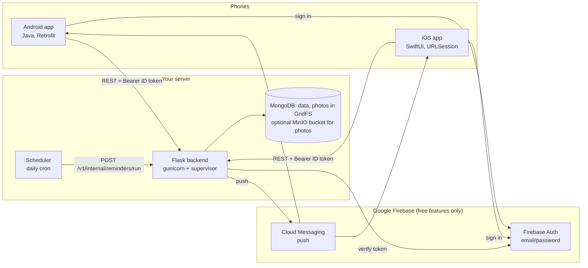
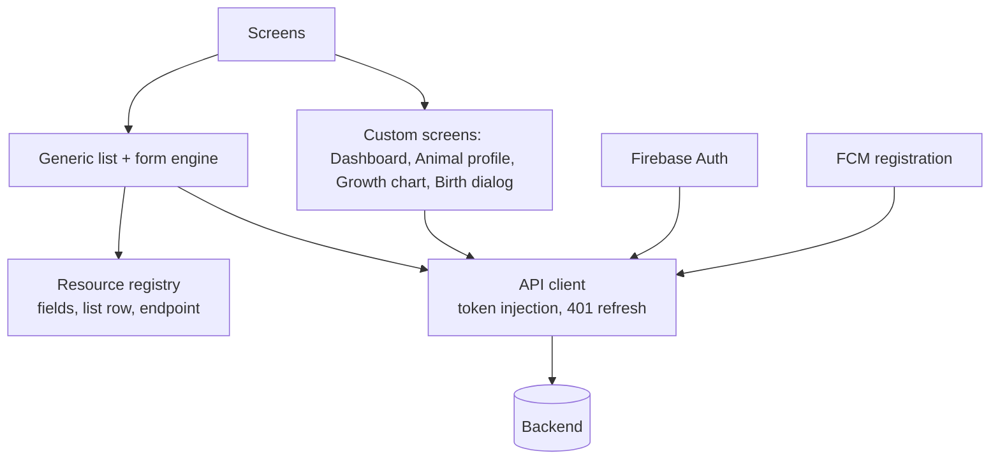

# Architecture

## 1. Big picture



Principles:
- **Thin clients, smart server.** The apps hold no business rules beyond input forms; the server validates everything, computes ages, expected birth dates, reminders, dashboard totals and reports.
- **One source of truth:** MongoDB. Firebase provides identity and push delivery only.
- **Private by construction:** every record lives under a farm; every request is resolved to the caller's farm from their verified token. There is no farm id in any URL, so a user cannot address another farm's data.

## 2. Backend (`farmivo_backend`)

```
app/
  main.py            Flask app factory create_app(), blueprint registration, /healthz; exposes `app` for gunicorn
  config.py          Settings from FARMIVO_* env vars (DB backend, Mongo URI, public URL, secrets)
  deps.py            Wiring: Firebase init, repository/photo store selection (tests inject fakes via
                     create_app(overrides=...)), get_identity (verifies the ID token), get_ctx (active membership -> farm + role)
  errors.py          ApiError + JSON error handlers (every error body is {"detail": ...})
  web.py             Request/response helpers: body(model) -> 422 on bad input, out(...), query-string parsers
  repository.py      Storage abstraction: MongoRepository (default), FirestoreRepository, InMemoryRepository (tests)
  schemas.py         Pydantic models = the API contract and all validation rules
  utils.py           Age calculation, gestation table
  routers/
    crud.py          Generic CRUD blueprint factory (list/get/create/patch/delete + hooks)
    animals.py       Animals, status changes, photo upload, family tree, delete cascade
    health.py        Vaccinations, treatments, vet visits, illnesses, reminders endpoints
    breeding.py      Breedings, birth recording (creates offspring)
    growth.py        Weights, production, feeding, growth stats, production summary
    finance.py       Transactions, finance summary
    dashboard.py     Aggregated dashboard payload
    notifications.py In-app notifications, read/unread
    reports.py       JSON/CSV reports
    photos.py        Serves photos stored in MongoDB (public, unguessable id)
    farm.py          Farm settings, device (FCM token) registration
    internal.py      Cron-only endpoint that sends due-reminder pushes
  services/
    reminders.py     Reminder sync + daily notification run
    notifier.py      FcmNotifier (prod) / NullNotifier (tests)
    photos.py        GridFsPhotoStore (default), MinioPhotoStore, FirebasePhotoStore, MemoryPhotoStore
tests/               pytest suite, runs on the in-memory repository (no database needed)
```

### Request lifecycle
1. App sends `Authorization: Bearer <Firebase ID token>`.
2. `get_current_uid` verifies the token with Firebase Admin → `uid`.
3. `get_ctx` loads `users/{uid}` and the member record; without an active membership it answers `403` (`no_farm`, `pending` or `rejected`), otherwise it checks the role for this route (`app/permissions.py`, `403 forbidden_role`). Result: `Ctx(uid, farm_id, repo, role, farm)`. Farms are created only by `POST /v1/farms`.
4. The blueprint view reads/writes only `farms/{farm_id}/<collection>` through the `Repository` interface.
5. Pydantic validates input (unknown fields rejected → `422`) and shapes output.

### Repository pattern
All data access goes through six methods (`get`, `list`, `create`, `update`, `set`, `delete`) addressed by Firestore-style paths such as `farms/{farm_id}/animals`. Equality filters are pushed to the database; range filters, sorting and limits run in Python (a single farm has at most a few thousand documents per collection). This keeps the project free of index management and makes the database swappable (see DECISIONS.md).

### Generic CRUD factory
Most record types (vaccinations, treatments, vet visits, illnesses, breedings, weights, production, feedings, transactions) are produced by `build_crud_blueprint(...)` from a create-model, an update-model (auto-generated all-optional copy), an output model and optional hooks (`before_create`, `after_write`, `after_delete`, `enrich`). PATCH re-validates the merged record, so cross-field rules (e.g. next vaccination not before date given) hold on edits.

### Reminders (feature 2 "automatic reminders")
- A source record that has a due date owns exactly one reminder with a deterministic id (`vacc_<id>`, vet visit follow-up, breeding expected birth). Create/update/delete of the source calls `sync_reminder` / `delete_reminder`, so the reminder always mirrors the record; changing the date resets notification state.
- A daily cron job calls `POST /v1/internal/reminders/run` (header `X-Cron-Secret`) once a day. For each pending reminder the server computes `days_until` and the **bucket**: 7 days, 1 day, today, overdue. Each bucket notifies once (`notified_buckets`): the server stores an in-app notification and pushes via FCM to every device registered by the farm's active members (pending or removed people get nothing); invalid tokens are removed.
- Selling or losing an animal closes its pending reminders.

### Photos
Apps resize to ~1600 px JPEG and upload multipart to `POST /animals/{id}/photo` (≤ 5 MB, JPEG/PNG/WebP). The server stores the bytes in MongoDB GridFS (default) or a private MinIO bucket (`FARMIVO_PHOTO_STORE=minio`) and returns `photo_url = <PUBLIC_BASE_URL>/v1/photos/<id>`. The API streams the image back from the store (the bucket itself is never public). That endpoint is public with an unguessable id, so image loaders (Glide, AsyncImage) need no auth header, and responses are cached for a year (`immutable`).

## 3. Mobile apps (same design on both platforms)



- **Records are untyped JSON** (`JsonObject` on Android, `[String: JSONValue]` on iOS). A single **resource registry** (`ui/Resources.java`, `Features/Shared/Views/Resources.swift`) declares each record type: endpoint, form fields (type, required, defaults), and how to render a list row. One generic list screen and one generic form implement create/edit/delete for ten record types. To add a field: add one line to the registry.
- **API client** adds the Firebase ID token to every request; on `401` it refreshes the token once and retries; if it still fails the user is signed out.
- **Animal cache** (`Animals` / `AnimalStore`) holds animals on the farm for pickers and for labelling records ("Bella (CR-0412)").
- **Navigation:** 5 tabs (Dashboard, Animals, Health, Breeding, More). Health/Growth use a segmented switcher over several resources. An animal's detail screen has Profile / Health / Growth tabs, reusing the same generic screens filtered to that animal.
- **Push:** app registers its FCM token via `POST /devices` after login and on token refresh; removes it on sign-out.

## 4. Security model
- Auth: Firebase ID tokens verified server-side on every call; no passwords reach the backend.
- Authorization: farm scoping from the token (see above). Cron endpoint protected by a shared secret compared in constant time.
- Input: strict Pydantic schemas, size limits (photo 5 MB, text lengths), unknown fields rejected.
- Photos are public-by-URL but unguessable; do not treat them as confidential.
- MongoDB must not be exposed publicly: use Atlas with an IP allow-list/VPC peering or keep it on a private network.

## Members and roles

A farm has one owner and any number of managers, workers and viewers. People join with the farm's invite code and are approved by a manager or the owner. Every farm request goes through `get_ctx`, which requires an active membership and checks the role with `app/permissions.py`. Details: [ROLES_AND_MEMBERS.md](ROLES_AND_MEMBERS.md).
