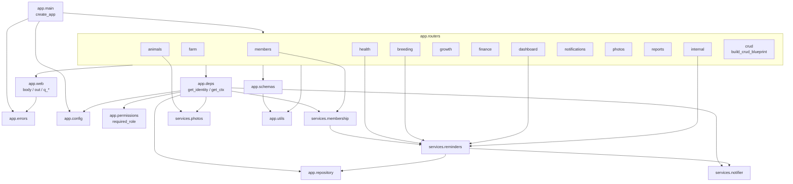

# Code reference (backend)

Every module, class, function and route in `app/` and `scripts/`, what it does and how the pieces call each other. The request and response formats seen by the apps are in [API.md](API.md), and the screen-by-screen walkthrough with real responses is in [APP_FLOWS.md](APP_FLOWS.md). How the backend, Android and iOS fit together is in [SYSTEM_GUIDE.md](SYSTEM_GUIDE.md).

Conventions used below:
- **Path**: records are addressed by a Firestore-style path plus an id, for example `farms/<farm_id>/animals`. With MongoDB the last part of the path is the collection name and the parent ids become fields (`farm_id`, `user_id`).
- **Identity**: the caller from the token (uid, email, name). **Ctx**: the request context of an active farm member, holding the uid, farm id, role, farm and repository.
- **Errors**: every `ApiError(status, detail, code=None)` becomes the JSON answer `{"detail": detail}` (plus `"code"` when set) with that HTTP status.
- **Roles**: owner > manager > worker > viewer; see [ROLES_AND_MEMBERS.md](ROLES_AND_MEMBERS.md).

## Contents

1. [Module map](#1-module-map)
2. [app/main.py](#2-appmainpy): application factory
3. [app/config.py](#3-appconfigpy): settings
4. [app/deps.py](#4-appdepspy): auth, farm context, services; [app/permissions.py](#4a-apppermissionspy): roles policy
5. [app/errors.py](#5-apperrorspy) and [app/web.py](#6-appwebpy): errors and request helpers
6. [app/repository.py](#7-apprepositorypy): storage
7. [app/schemas.py](#8-appschemaspy): request and response models
8. [app/utils.py](#9-apputilspy)
9. [app/services/](#10-appservices): reminders, push, photos, membership
10. [app/routers/](#11-approuters): all endpoints
11. [scripts/](#12-scripts)
12. [tests/](#13-tests)
13. [Coverage check](#14-coverage-check)

---

## 1. Module map



| Module | Purpose | Uses (app modules) | Used by |
|---|---|---|---|
| `app/main.py` | Creates the Flask app, registers blueprints and error handlers; `app` is the gunicorn entry point | config, errors, routers | gunicorn, tests, scripts.seed_demo |
| `app/config.py` | Settings from `FARMIVO_*` variables and `.env` | none | everything |
| `app/deps.py` | Token check (identity), membership and role context, lazily created DB / push / photo services | config, errors, permissions, repository, services.membership, services.notifier, services.photos | all routers, scripts |
| `app/permissions.py` | Roles and the one permission policy (`required_role`) | none | deps, dashboard, farm router, membership |
| `app/errors.py` | `ApiError` and the JSON error handlers | none | web, deps, routers |
| `app/web.py` | Parse JSON bodies and query strings, build JSON responses | errors | routers |
| `app/repository.py` | Storage interface and its MongoDB / Firestore / in-memory versions | none | deps, routers, services |
| `app/schemas.py` | Pydantic models for every request and response | utils | routers |
| `app/utils.py` | Dates, ages, gestation table | none | schemas, routers, services |
| `app/services/reminders.py` | Reminders owned by records, the daily push job | repository, notifier, utils | health, breeding, dashboard, internal |
| `app/services/membership.py` | Farm members: create, join, approve, reject, roles, invite codes, transfer, legacy upgrade | repository, errors, services.reminders | deps, members router, farm router, verification |
| `app/services/verification.py` | Email verification: 6-digit code, hash, cooldown, attempts, verified flag | repository, errors, services.mailer, services.membership | members router |
| `app/services/mailer.py` | Sends the code email through Mailjet, or writes it to the log | none | deps, verification, scripts.check_setup |
| `app/services/notifier.py` | Push senders (FCM, test double) | none | deps, reminders |
| `app/services/photos.py` | Photo stores (GridFS, MinIO, Firebase Storage, memory) | none | deps, animals, photos router |
| `app/routers/*.py` | One module per feature area | crud, deps, web, schemas, services | main |
| `scripts/*.py` | Server tools: setup check, demo data, data migration | config, deps, repository, main | run by hand on the server |

---

## 2. app/main.py

Flask application factory and WSGI entry point (`gunicorn app.main:app`).

| Name | Kind | Description |
|---|---|---|
| `API_PREFIX` | constant | `"/v1"`, the prefix of every API route. |
| `create_app(overrides=None) -> Flask` | function | Builds the app. Turns off trailing-slash redirects, keeps JSON key order, stores `overrides` (tests inject `repo`, `notifier`, `photo_store`, `uid`) in `app.config["FARMIVO_OVERRIDES"]`, and sets `MAX_CONTENT_LENGTH` to the photo limit + 1 MB. Enables CORS only if `FARMIVO_CORS_ORIGINS` is set. Registers the error handlers and, for MongoDB without a test repo, calls `log_mongo_target`. Adds `GET /healthz` and registers all blueprints (section 11). |
| `healthz()` | route (nested in `create_app`) | `GET /healthz` → `{"status": "ok"}`. No auth, no database: it only proves the process is up. |
| `log_mongo_target(app, settings)` | function | At startup, logs which settings file was read (or `NOT FOUND`) and `MongoDB: <host>, database <db>, user <user>`. If the host cannot be read from the connection string it logs an error instead. Never logs the password. |
| `app` | module variable | `create_app()`; what gunicorn serves. |

Blueprint registration (all under `/v1`): `farm`, `animals`, `health` (vaccinations, treatments, vet-visits, illnesses), `growth` (weights, production, feedings), `finance`, `dashboard`, `notifications`, `photos`, `reports`, `internal`; `breeding.bp` under `/v1/breedings`; `health.reminders_bp`; `growth.growth_bp` (growth chart).

---

## 3. app/config.py

| Name | Kind | Description |
|---|---|---|
| `ENV_FILE` | constant | Absolute path of `.env` next to the `app/` folder. Used whatever directory the server starts in. |
| `Settings` | class (pydantic-settings) | All settings. Field `x` is read from `FARMIVO_X` (environment first, then `.env`; unknown variables are ignored). |
| `Settings.mongo_url` | property | The MongoDB connection string: `FARMIVO_MONGO_URI` (quotes trimmed) if set; otherwise built as `mongodb://<user>:<password>@<host>:<port>/?authSource=<auth_db or mongo_db>` with user and password URL-encoded, or `mongodb://<host>:<port>` without a user. |
| `Settings.code_hash_secret` | property | Key for hashing email codes: `code_secret`, else `cron_secret`, else a fixed fallback. |
| `Settings.cors_origin_list` | property | `cors_origins` split on commas. |
| `get_settings() -> Settings` | function, cached | One `Settings` per process. A changed `.env` needs a restart. |

`Settings` fields:

| Field (env `FARMIVO_…`) | Default | Meaning |
|---|---|---|
| `firebase_project_id` | none | Firebase project whose ID tokens are accepted (`farmivo-4d932`). |
| `firebase_storage_bucket` | none | Only for the Firestore setup's photo storage. |
| `firebase_credentials` | none | Path to the service-account key JSON (absolute or relative to the project folder). Needed to verify tokens and send pushes. |
| `db_backend` | `mongo` | `mongo` or `firestore`. |
| `mongo_host`, `mongo_port` | `localhost`, `27017` | MongoDB server. |
| `mongo_user`, `mongo_password` | none | MongoDB login; the password needs no escaping. |
| `mongo_auth_db` | none (= `mongo_db`) | Database where the user was created. |
| `mongo_uri` | none | Full connection string; overrides the fields above. |
| `mongo_db` | `farmivo` | Database holding Farmivo's collections. |
| `mongo_prefix` | `""` | Prefix for collection names when sharing another app's database. |
| `public_base_url` | `http://localhost:8000` | Public address of the API; used to build photo URLs. |
| `photo_store` | `gridfs` | `gridfs` or `minio`. |
| `minio_endpoint`, `minio_access_key`, `minio_secret_key`, `minio_bucket`, `minio_secure` | `localhost:9000`, none, none, `farmivo-photos`, `false` | MinIO photo store. |
| `cron_secret` | none | Secret expected in `X-Cron-Secret` by the reminder job. If unset, the job endpoint always answers 403. |
| `code_secret` | none | Key for hashing email verification codes. |
| `mailjet_api_key`, `mailjet_api_secret` | `""` | Mailjet credentials, read from `MAILJET_API_KEY` / `MAILJET_API_SECRET` (or the `FARMIVO_`-prefixed names). Empty key: the code is logged instead (`LogMailer`). |
| `mail_from_email`, `mail_from_name`, `mail_timeout` | `contact@quadralens.tn`, `Farmivo`, 10 | Sender of the code email (must be validated in Mailjet) and the request timeout in seconds. |
| `cors_origins` | `""` | Allowed browser origins (the mobile apps need none). |
| `environment` | `development` | Informational. |
| `max_photo_bytes` | 5 MB | Upload limit for animal photos. |

---

## 4. app/deps.py

Request dependencies: authentication (identity), farm membership and role context, and the services, each created once per process.

| Name | Kind | Description |
|---|---|---|
| `_override(name)` | function | Returns a test override from `create_app(overrides=…)`, or `None`. Production never sets any. |
| `_firebase_app()` | function, cached | Initialises Firebase Admin once with `projectId` (and `storageBucket`). Loads the key from `FARMIVO_FIREBASE_CREDENTIALS` (relative paths are resolved from the project folder; raises `RuntimeError` if the file is missing). Without it, falls back to `GOOGLE_APPLICATION_CREDENTIALS` and logs an error if that is unset too, because every token would then be rejected. |
| `_mongo_db()` | function, cached | Creates the `MongoClient` (`tz_aware`, 5 s server-selection and connect timeouts) and returns the `mongo_db` database. Invalid settings raise `RuntimeError` with the fix in the message. |
| `_repo()` | function, cached | `FirestoreRepository` if `db_backend == "firestore"`, else `MongoRepository(_mongo_db(), mongo_prefix)`. |
| `_notifier()` | function, cached | Initialises Firebase and returns `FcmNotifier()`. |
| `_photo_store()` | function, cached | `MinioPhotoStore` if `photo_store == "minio"` (needs both keys, else `RuntimeError`); `FirebasePhotoStore` with Firestore; otherwise `GridFsPhotoStore(_mongo_db(), public_base_url, "<prefix>photos")`. |
| `_mailer()` | function, cached | `MailjetMailer` from the Mailjet settings, or `LogMailer` when `mailjet_api_key` is empty. |
| `get_repo()`, `get_notifier()`, `get_photo_store()`, `get_mailer()` | functions | The test override if present, else the cached service. |
| `get_identity() -> Identity` | function | Reads `Authorization: Bearer <token>`. Missing or not Bearer: **401 "Missing bearer token"**. Then `_firebase_app()` + `firebase_admin.auth.verify_id_token`. Any failure, such as a wrong project, expiry, clock skew or a missing key, logs `Rejected Firebase token: <reason>` and raises **401 "Invalid or expired token"**. Returns `Identity(uid, email, name, email_verified)` from the token claims, cached on `flask.g`. Used directly by the onboarding routes (`/me`, `/farms`, `/farms/join`, `/me/membership`, `/devices`), which work without a farm. Tests set the caller with the `uid`, `email`, `name` and `email_verified` overrides. |
| `get_current_uid() -> str` | function | `get_identity().uid`. |
| `Ctx` | dataclass | `uid`, `farm_id`, `repo`, `role` (owner, manager, worker, viewer), `farm` (the farm document). |
| `Ctx.require(minimum)` | method | Raises **403** `code: forbidden_role` ("Your role (worker) does not allow this") unless `role` is `minimum` or higher. |
| `get_ctx() -> Ctx` | function | Called first by every farm route. Gets the identity, then `membership.resolve`: `pending` → **403 code pending** ("Your request to join <farm> is waiting for approval"), `rejected` → **403 code rejected**, no active membership → **403 code no_farm** ("You are not a member of a farm yet"). Then checks the role against `required_role(request.method, request.path)` (403 `forbidden_role`). Nothing is created automatically. The result is cached on `flask.g` for the rest of the request. |

---

## 4a. app/permissions.py

The whole permission policy in one place; `get_ctx` applies it to every farm request, so new routes are protected without extra code.

| Name | Description |
|---|---|
| `ROLES`, `RANK` | `owner` 4 > `manager` 3 > `worker` 2 > `viewer` 1. |
| `at_least(role, minimum) -> bool` | True if `role` ranks at or above `minimum`. |
| `can_see_finance(role) -> bool` | Manager or owner. Used by the dashboard to return `finance: null` for others. |
| `required_role(method, path) -> str` | First match wins: `/farm/transfer-ownership` owner; `/transactions`, `/finance`, `/reports/financial`, `/farm/members`, `/farm/invite-code` manager; any `GET` viewer; `/notifications/.../read` and `/read-all` viewer; other notification writes worker; `PATCH /farm` manager; any other `DELETE` manager; any other `POST`/`PATCH` worker. The path may include `/v1`. |

---

## 5. app/errors.py

| Name | Kind | Description |
|---|---|---|
| `ApiError(status, detail, code=None, extra=None)` | exception | `status` is the HTTP code; `detail` is a string or a list of field errors; `code` (optional) is a machine-readable reason added to the body (`no_farm`, `pending`, `rejected`, `forbidden_role`, `email_unverified`, and the email-code errors); `extra` adds more fields, e.g. `retry_after`. |
| `validation_error(exc) -> ApiError` | function | Pydantic `ValidationError` → `ApiError(422, [ {loc, msg, type, …} ])`. |
| `register_error_handlers(app)` | function | Installs three nested handlers, `_api_error`, `_http_error` and `_unexpected`. `ApiError` → `{"detail": …}` (plus `"code"` and `extra` fields if set) with its status. Werkzeug HTTP errors such as an unknown route (404), a wrong method (405) or a too-large body (413) → `{"detail": "<name>"}`. Any other exception is logged with its traceback; a `PyMongoError` becomes **503 "Database unavailable"**, anything else **500 "Internal server error"**. |

## 6. app/web.py

| Name | Description |
|---|---|
| `body(model)` | Parses the JSON body into `model`. A missing or non-object body is **422 "Request body must be a JSON object"**; validation errors are 422 with the field list. |
| `out(value, status=200)` | JSON response from a model, a list of models or plain data (inner helper `conv`) (`model_dump(mode="json")`, so dates become `YYYY-MM-DD`). |
| `no_content()` | Empty **204**. |
| `_bad(name, msg)` | 422 `ApiError` for a query parameter, in the same format as body errors (`loc: ["query", name]`). |
| `q_str(name, default)` | Text parameter; empty means `default`. |
| `q_int(name, default, ge, le)` | Integer within bounds, else 422. |
| `q_bool(name, default)` | `1/true/yes/on/t/y` or `0/false/no/off/f/n`, else 422. |
| `q_date(name)` | `YYYY-MM-DD`, else 422. |
| `q_enum(name, enum, default, required)` | One of the enum's values; 422 if invalid, or if missing and `required`. |

---

## 7. app/repository.py

| Name | Kind | Description |
|---|---|---|
| `Filter` | type alias | `(field, op, value)` with `op` one of `== != < <= > >= in`. |
| `now_iso()` | function | UTC now as ISO text, used for `created_at` / `updated_at`. |
| `_matches(doc, flt)` | function | Evaluates one filter on one document. A missing field only matches `!=`; type mismatches don't match. An unknown operator raises `ValueError`. |
| `apply_query(docs, filters, order_by, desc, limit)` | function | Filters, sorts (records without the sort field go last) and limits in Python. |
| `Repository` | Protocol | `get(path, id)`, `list(path, filters, order_by, desc, limit)`, `create(path, data, id=None)`, `update(path, id, data)` (returns `None` if missing), `set(path, id, data)` (upsert, keeps `created_at`), `delete(path, id) -> bool`. Every returned record has an `"id"` key plus its fields, `created_at` and `updated_at`. |
| `InMemoryRepository` | class | Dict of dicts keyed by path; deep-copies on read and write. Tests and `seed_demo --memory`. `_col(path)` returns or creates one path's dict. |
| `FirestoreRepository` | class | Uses `client.collection(path)`; `==` filters run in Firestore and the rest in `apply_query`. `_to_dict(snap)` adds the id. |
| `MongoRepository(db, prefix="")` | class | **One collection per record type.** `_locate(path)` returns the collection named `prefix + <last part>` and the parent fields from the path (`farms/F/animals` → `{farm_id: F}`, `users/U/devices` → `{user_id: U}`). It creates an index on the parent fields the first time a collection is used. Records store `_id = id` plus the parent fields; `_out` removes `_id` and the parent fields and adds `"id"`. `==` filters (not on parent fields) and `in` filters run in MongoDB; the rest in `apply_query`. Every query includes the parent fields, so one farm can never read another farm's records. |
| `farm_path(farm_id, collection)` | function | `"farms/<farm_id>/<collection>"`. |

Collections in MongoDB: `farms`, `users`, `devices`, `animals`, `vaccinations`, `treatments`, `vet_visits`, `illnesses`, `reminders`, `breedings`, `weights`, `production`, `feedings`, `transactions`, `notifications`, plus GridFS `photos.files` / `photos.chunks`. Each name gets the prefix if one is set.

---

## 8. app/schemas.py

Pydantic models. Request bodies extend **`Strict`** (unknown fields → 422, strings trimmed). Responses extend **`Record`** (`id`, `created_at`, `updated_at`; unknown stored fields ignored). `make_partial(model, name)` builds the PATCH model in which every field is optional and unknown fields are still rejected.

Enums: `Species` (cattle, sheep, goat, pig, horse, chicken, duck, rabbit, other), `Sex` (male, female), `AnimalStatus` (active, sick, quarantine, sold, deceased; `ON_FARM_STATUSES` = active, sick, quarantine), `Origin` (born_on_farm, purchased, other), `PregnancyStatus` (pending, confirmed, not_pregnant, delivered, aborted), `MatingMethod` (natural, artificial_insemination), `Product` (milk, eggs, wool, meat, other; `DEFAULT_UNIT` liters/count/kg/kg/units), `TransactionType` (income, expense).

| Model | Used for | Notes |
|---|---|---|
| `FarmUpdate` / `FarmOut` | PATCH / GET `/farm` | name 1–80 characters, currency 3 letters (upper-cased by `_upper`), country ≤ 60, address ≤ 200. Out adds `owner_uid`, `invite_code` (null below manager) and `role` (the caller's). |
| `FarmCreate` | POST `/farms` | name 2–80, address 5–200 (both required), country ≤ 60, currency 3 letters (upper-cased). |
| `JoinIn` | POST `/farms/join` | `invite_code` 4–20 characters (normalised by the service). |
| `MeFarm`, `MeOut` | GET `/me` and the onboarding calls | `uid`, `email`, `status` (none, pending, active, rejected), `role` (only when active), `farm` `{id, name}` or null, `email_verified`. |
| `VerifyIn` | POST `/me/verification/verify` | `code` (1–20 characters; spaces are removed by the service). |
| `VerificationSentOut` | POST `/me/verification/send` response | `sent_to`, `resend_after_seconds`, `expires_in_seconds`. |
| `AssignableRole`, `ApproveIn`, `RoleIn` | approve / change role | Role must be `manager`, `worker` or `viewer` (`owner` only by transfer); approve defaults to `worker`. |
| `TransferIn` | POST `/farm/transfer-ownership` | `uid` of the new owner. |
| `MemberOut` | members list and actions | `uid`, `email`, `name`, `role`, `status`, `requested_at`, `decided_at`, `decided_by`. |
| `InviteCodeOut` | POST `/farm/invite-code` | `invite_code`. |
| `AnimalBase`, `AnimalCreate`, `AnimalUpdate`, `AnimalOut` | animals | Required: ear_tag (1–40), species, sex. `date_of_birth` cannot be in the future (`_dob_not_future`). `date_added` defaults to today, `origin` to purchased. Create adds `status` (default active) and `photo_url`. Out adds `status_date`, `photo_url`, `age_days`, `age_months`, `age_label`. |
| `StatusChange` | POST `/animals/<id>/status` | `status`, `date` (default today), `sale_price` ≥ 0, `buyer`, `notes`. |
| `FamilyOut` | GET `/animals/<id>/family` | `animal`, `mother`, `father`, `siblings[]`, `offspring[]`. |
| `VaccinationBase`, `VaccinationUpdate`, `VaccinationOut` | vaccinations | `animal_id`, `vaccine_name`, `date_given`, `next_due_date` (not before date_given, `_due_after_given`), `batch_number`, `administered_by`, `notes`. |
| `TreatmentBase`, `TreatmentUpdate`, `TreatmentOut` | treatments | `animal_id`, `name`, `medication`, `dosage`, `start_date`, `end_date`, `withdrawal_end_date`, `administered_by`, `notes`. |
| `VetVisitBase`, `VetVisitUpdate`, `VetVisitOut` | vet visits | `animal_id`, `visit_date`, `vet_name`, `reason`, `diagnosis`, `notes`, `follow_up_date`. |
| `IllnessBase`, `IllnessUpdate`, `IllnessOut` | illnesses | `animal_id`, `condition`, `start_date`, `recovery_date`, `symptoms`, `notes`. Out adds `status` ongoing/recovered. |
| `ReminderCreate` / `ReminderOut` | reminders | Out: `source_type` (vaccination, vet_visit, birth, custom), `source_id`, `animal_id`, `title`, `due_date`, `status` (pending/done), `days_until`. |
| `BreedingBase`, `BreedingUpdate`, `BreedingOut` | breedings | `dam_id`, `sire_id` or `sire_note`, `mating_date`, `method`, `pregnancy_status`, `pregnancy_confirmed_date`, `expected_birth_date`, `notes`. Out adds `actual_birth_date`, `offspring_ids`. |
| `OffspringIn`, `BirthRequest`, `BirthOut` | POST `/breedings/<id>/births` | 1–20 offspring, each with `ear_tag`, `name`, `sex`, `birth_weight_kg`, `stillborn`. |
| `WeightBase`, `WeightUpdate`, `WeightOut` | weights | `animal_id`, `date`, `weight_kg` (0 < w < 5000), `notes`. |
| `ProductionBase`, `ProductionUpdate`, `ProductionOut` | production | `animal_id` optional (herd level), `date`, `product`, `quantity` ≥ 0, `unit` (defaults from the product, `_default_unit`), `notes`. |
| `FeedingBase`, `FeedingUpdate`, `FeedingOut` | feedings | `animal_id` or `group_name`, `date`, `feed_type`, `quantity_kg` > 0, `notes`. |
| `GrowthPoint`, `GrowthOut` | growth chart | `points[]`, `latest_weight_kg`, `total_gain_kg`, `average_daily_gain_kg`. |
| `DailyTotal`, `ProductionSummary` | production summary | `product`, `unit`, period, `total`, `days_with_records`, `average_per_record_day`, `daily[]`. |
| `TransactionBase`, `TransactionUpdate`, `TransactionOut` | transactions | `type`, `category`, `amount` > 0, `date`, `description`, `animal_id`. |
| `MonthlyFinance`, `FinanceSummary` | finance summary | Period, currency, income, expenses, net, per-category maps, `monthly[]`. |
| `NotificationOut` | notifications | `title`, `body`, `type`, `animal_id`, `reminder_id`, `read`. |
| `DeviceIn` | POST `/devices` | `token` (10–4096 characters), `platform` android/ios. |
| `UpcomingItem`, `DashboardOut` | dashboard | See section 11.9. `finance` is optional (null for workers and viewers). |

---

## 9. app/utils.py

| Name | Description |
|---|---|
| `GESTATION_DAYS` | cattle 283, sheep 147, goat 150, pig 114, horse 340, rabbit 31 days. |
| `today()` | `date.today()`. |
| `parse_date(value)` | Date, ISO text (first 10 characters) or `None`. |
| `age_parts(dob, until=None)` | `(days, months, label)`. Labels look like `4y 7m`, `4y`, `7m` or `12d`. `until` is used for deceased animals. |
| `expected_birth(species, mating)` | `mating + GESTATION_DAYS[species]`, or `None`. |

---

## 10. app/services

### 10.1 services/reminders.py

Reminders are owned by a source record and have a predictable id: `vacc_<vaccination id>`, `vet_<vet visit id>`, `birth_<breeding id>`. Saving the source creates, moves or removes its reminder, so they never drift apart.

| Name | Description |
|---|---|
| `BUCKET_OVERDUE` | `-1`. |
| `reminder_bucket(days_until)` | `-1` if overdue, `0` today, `1` tomorrow, `7` within a week, else `None`. A reminder is pushed once per bucket. |
| `animal_label(repo, farm_id, animal_id)` | `"Name (TAG)"`, the name or tag alone, or `None`. |
| `sync_reminder(repo, farm_id, reminder_id, *, source_type, source_id, animal_id, title, due_date)` | No date: deletes the reminder. Otherwise upserts `farms/<farm>/reminders/<reminder_id>`. If the due date changed, status resets to `pending` and `notified_buckets` to `[]`; otherwise both are kept. |
| `delete_reminder(repo, farm_id, reminder_id)` | Deletes it (no error if missing). |
| `farm_member_uids(repo, farm, roles=None)` | Uids of the farm's **active** members (only those with one of `roles` if given). Farms without member records yet fall back to `owner_uid` / `member_uids`. Pending and rejected people never receive farm pushes. |
| `device_tokens(repo, uids)` | `(uid, token)` for every registered phone of these users. |
| `farm_device_tokens(repo, farm, roles=None)` | `device_tokens` of `farm_member_uids`. |
| `_send(repo, notifier, pairs, title, body, data)` | Pushes and deletes device records whose token FCM reports as invalid. |
| `push_to_users(repo, notifier, uids, title, body, data)` | Push to specific people without storing a farm notification (approval and rejection messages). |
| `notify_farm(repo, notifier, farm, *, title, body, type_, animal_id, reminder_id, roles=None)` | Writes a `notifications` record (`read: false`) and pushes it to the active members' devices; `roles` limits the push (not the stored record), e.g. `{"owner", "manager"}` for join requests. |
| `run_due_reminders(repo, notifier, as_of=None) -> {"farms", "notified"}` | For every farm and every pending reminder: computes the bucket and skips it if already notified. Otherwise it builds a body like `Bella (CR-0412): Vaccination due: … is due tomorrow`, calls `notify_farm` and appends the bucket to `notified_buckets`. |

### 10.1a services/membership.py

Who belongs to which farm, with which role, and the join workflow. Storage: `farms/<farm_id>/members/<uid>` (collection `members`), `users/<uid>` (`farm_id`, `status`), `farms.owner_uid` and `farms.invite_code`.

| Name | Description |
|---|---|
| `CODE_ALPHABET` | Characters used in invite codes, without look-alikes (no 0/O, 1/I/L). |
| `Identity` | dataclass: `uid`, `email`, `name`, `email_verified` (the token's claim). |
| `set_user(repo, uid, farm_id, status)` | Writes `users/<uid>` (`farm_id`, `status`) keeping `email_verified` / `email_verified_at`. `farm_id=None` keeps only the verified flag (the document is deleted if there is none). Used by every membership change. |
| `Membership` | dataclass: `status` (none, pending, active, rejected), `farm`, `member`; property `role` (only when active). |
| `members_path(farm_id)` | `farms/<farm_id>/members`. |
| `code_prefix(farm_name)` | Three letters: initials for 3+ words ("Green Valley Farm" → GVF), else the first letters ("My Farm" → MYF), `FRM` without Latin letters. |
| `normalize_code(text)` | Upper-case, strip spaces and dashes, re-insert the dash: `" gvf 7k3p "` → `GVF-7K3P`. |
| `find_farm_by_code(repo, code)` | The farm with that (normalised) code, or `None`. |
| `new_invite_code(repo, farm_name)` | `PREFIX-XXXX` with 4 random characters (`SystemRandom`), unique among farms. |
| `ensure_invite_code(repo, farm)` | Adds a code to a farm that has none (farms created before codes existed). |
| `resolve(repo, identity) -> Membership` | Reads `users/<uid>`, the farm and the member record. A legacy account (user points at a farm it owns or is listed in, but no member record) becomes an **active owner** (or manager if only listed in `member_uids`). Fills a missing email/name from the token. |
| `me_payload(identity, membership, email_verified=False)` | The `GET /me` body, including `email_verified`. |
| `list_members(repo, farm_id)` | Pending (oldest first), then active (owner, managers, workers, viewers, then by name). Rejected are left out. |
| `label(member)` | Name, else email, else "Someone". |
| `create_farm(repo, identity, data)` | 409 if active or pending. Creates the farm (`owner_uid`, `invite_code`, currency default USD), an active owner member and `users/<uid>`. |
| `request_to_join(repo, notifier, identity, code)` | 409 if active. 404 "No farm with this code". Replaces a pending request elsewhere, writes a pending member (role worker) and `users/<uid>` status pending, and calls `notify_farm(..., type_="join_request", roles={"owner","manager"})`. |
| `leave(repo, identity)` | Deletes the member record and clears the farm from `users/<uid>` (the verified flag stays); 409 "Transfer ownership first" for the owner. |
| `_get_member(repo, farm_id, uid)` | The member or 404 "Member not found" (rejected records count as not found). |
| `_decide(repo, farm_id, uid, decided_by, **fields)` | Updates a member with `decided_at` / `decided_by`. |
| `approve(repo, notifier, farm, uid, role, decided_by)` | Pending only (409 otherwise). Sets active + role, `users/<uid>` active, pushes "Welcome to <farm>". |
| `reject(repo, notifier, farm, uid, decided_by)` | Pending only. Sets rejected, `users/<uid>` rejected, pushes "Request not accepted". |
| `change_role(repo, farm_id, uid, role, decided_by)` | Active non-owner members only (409 otherwise). |
| `remove(repo, farm_id, uid)` | Deletes the member record and clears the farm from `users/<uid>`; 409 for the owner. |
| `rotate_invite_code(repo, farm)` | New unique code; the old one stops matching immediately. |
| `transfer_ownership(repo, farm, from_uid, to_uid)` | Target must be another active member (409). Old owner → manager, target → owner, `farms.owner_uid` updated. |

### 10.1b services/verification.py

The 6-digit email code required before creating or joining a farm. Storage: `email_codes/<uid>` (hash only) and `users/<uid>.email_verified`.

| Name | Description |
|---|---|
| `CODE_LENGTH`, `CODE_TTL`, `RESEND_AFTER`, `MAX_SENDS_PER_HOUR`, `MAX_ATTEMPTS` | 6 digits, 15 minutes, 60 seconds, 5 codes per hour, 5 wrong tries. |
| `now()` | Current UTC time; a function so tests can move the clock. |
| `_iso(moment)`, `_parse(text)` | ISO-8601 strings to and from `datetime`. |
| `hash_code(uid, code, secret)` | HMAC-SHA256 keyed with `secret:uid`; only this is stored. |
| `is_verified(repo, identity, membership=None)` | True if `users/<uid>.email_verified`, or the token claim `email_verified`, or an active membership (older accounts). The last two are saved with `mark_verified`. |
| `mark_verified(repo, uid)` | Sets `email_verified` and `email_verified_at` on `users/<uid>`, keeping its other fields. |
| `send_code(repo, mailer, identity, secret) -> dict` | **409 already_verified**, **400 no_email**, **429 too_soon** (`retry_after`) within 60 s, **429 too_many_codes** after 5 in an hour. Creates a random code (`secrets`), emails it (**502 email_failed** on `MailError`, no cooldown started), then stores the hash, `expires_at`, `attempts=0`, `last_sent_at`, `sent_at`. Returns `{sent_to, resend_after_seconds, expires_in_seconds}`. |
| `verify_code(repo, identity, code, secret)` | Spaces are ignored. Already verified: no-op. No code or expired: **410 code_expired**. Right: deletes the code, `mark_verified`. Wrong: **400 wrong_code** "Wrong code. N attempts left"; the 5th wrong try burns the code (**429 too_many_attempts**). |

### 10.1c services/mailer.py

| Name | Description |
|---|---|
| `MailError` | The email could not be sent (bad API key, unvalidated sender, network error, Mailjet refusal). |
| `Mailer` | Protocol: `send_code(to, code, minutes)`. |
| `code_text(code, minutes) -> str` | Plain-text body: the code, the expiry, "ignore this email", "Powered by Quadralens". |
| `code_html(code, minutes) -> str` | Branded HTML body (teal header, spaced code, 15-minute note, "ignore this email", "Powered by Quadralens"). |
| `code_message(sender_email, sender_name, to, code, minutes) -> dict` | Mailjet Send API v3.1 payload: From (email, name), To, Subject "Your Farmivo verification code", TextPart, HTMLPart, CustomID `farmivo-verification`. |
| `MailjetMailer(api_key, api_secret, sender_email, sender_name, timeout)` | `send_code` posts `code_message` with `mailjet_rest.Client(version="v3.1").send.create` and raises `MailError` unless Mailjet answers 200 with `Status: success`. `check()` lists the account's active senders through the v3 `sender` resource (used by `check_setup`); `_client(version)` builds the client. |
| `LogMailer` | Used when `MAILJET_API_KEY` is empty: logs "Email not configured; verification code for <email>: <code>" at WARNING (the Flask app log inside a request). |

### 10.2 services/notifier.py

| Name | Description |
|---|---|
| `Notifier` | Protocol: `send(tokens, title, body, data) -> invalid_tokens`. |
| `NullNotifier` | Stores each send in `self.sent` (tests). |
| `FcmNotifier.send` | `firebase_admin.messaging.send_each_for_multicast` in batches of 500. Collects tokens failing with `UnregisteredError` or `SenderIdMismatchError`; logs other failures and never raises. |

### 10.3 services/photos.py

| Name | Description |
|---|---|
| `ALLOWED_TYPES` | `image/jpeg → jpg`, `image/png → png`, `image/webp → webp`. |
| `PhotoStore` | Protocol: `save(farm_id, animal_id, content, content_type) -> url`. |
| `GridFsPhotoStore(db, public_base_url, collection="photos")` | **Default.** `save` puts the bytes in GridFS (metadata farm_id, animal_id) and returns `<public_base_url>/v1/photos/<ObjectId>`. `read(id)` returns `(bytes, content_type)` or `None`. |
| `MinioPhotoStore(...)` | Creates the bucket if missing. `save` stores the object under a random 32-hex id and returns `<public_base_url>/v1/photos/<id>`; `read` validates the id format and streams the object back. The bucket stays private. |
| `FirebasePhotoStore(bucket)` | Firestore setup only: uploads to Firebase Storage, makes the blob public and returns its URL. |
| `MemoryPhotoStore` | Tests: keeps bytes in a dict and returns `https://storage.test/...`. |

---

## 11. app/routers

Every route except `/healthz`, `/v1/photos/<id>` and `/v1/internal/reminders/run` calls `get_ctx()` first. A missing or invalid token therefore answers **401** before anything else runs, and all data is limited to the caller's farm. Bodies are parsed with `body(Model)`, which gives **422** on invalid input.

### 11.1 routers/crud.py: shared CRUD factory

| Name | Description |
|---|---|
| `Hook` | Type of the optional callbacks. |
| `path_of(ctx, collection)` | `farm_path(ctx.farm_id, collection)`. |
| `get_animal_or_404(ctx, animal_id)` | The animal or **404 "Animal not found"**. |
| `clean(record, model)` | Keeps only the model's fields (drops id and timestamps). |
| `build_crud_blueprint(*, name, collection, create_model, update_model, out_model, date_field=None, before_create=None, before_update=None, after_write=None, after_delete=None, enrich=None)` | Returns a Blueprint with the five routes below. Hooks: `before_create(ctx, data) -> data`, `before_update(ctx, existing, merged) -> merged`, `after_write(ctx, record)` (after create and update), `after_delete(ctx, record)`, `enrich(record) -> record` (before rendering). Nested helpers: `render` (enrich + `out_model`) and `check_animal` (404 if the body's `animal_id` is unknown). |

Routes generated for each collection (prefix shown in later sections):

| Route | Function | Behaviour |
|---|---|---|
| `GET ""` | `list_records` | Query: `animal_id`, `date_from`, `date_to` (on `date_field`), `limit` 1–1000 (default 200). Newest first by `date_field` (or `created_at`). **200** list. |
| `POST ""` | `create_record` | Validates `create_model`, checks `animal_id`, runs `before_create`, inserts, runs `after_write`. **201** record. |
| `GET "/<record_id>"` | `get_record` | **200**, or **404 "Record not found"**. |
| `PATCH "/<record_id>"` | `update_record` | Validates the PATCH, re-validates the **merged** record against `create_model` (so rules such as "due date after given date" still hold → 422), runs `before_update`, saves, runs `after_write`. **200**, or 404. |
| `DELETE "/<record_id>"` | `delete_record` | Deletes and runs `after_delete`. **204**, or 404. |

### 11.2 routers/farm.py

| Route | Function | Request | Response | Notes |
|---|---|---|---|---|
| `GET /v1/farm` | `get_farm` | none | `FarmOut` 200 | Any role. `role` is the caller's; `invite_code` only for manager and owner. |
| `PATCH /v1/farm` | `update_farm` | `FarmUpdate` | `FarmOut` 200 | Manager or owner. Fields sent as `null` are ignored. |
| `POST /v1/devices` | `register_device` | `DeviceIn` | 204 | Upserts `users/<uid>/devices` by token. Uses `get_identity`, so it works before the user has a farm (pending users get the approval push). |
| `DELETE /v1/devices?token=` | `unregister_device` | query `token` | 204 | 422 if `token` is missing. Works without a farm. |

`render_farm(ctx, farm)` builds the `FarmOut`: creates a missing invite code for managers and the owner (`ensure_invite_code`), hides it from workers and viewers, and adds the caller's role.

### 11.2a routers/members.py

Onboarding (token only, no farm needed) and member management. Rules live in `services/membership.py`.

| Route | Function | Request | Response | Who / errors |
|---|---|---|---|---|
| `GET /v1/me` | `me` | none | `MeOut` 200 | Anyone signed in. Also upgrades legacy accounts (see `resolve`) and reports `email_verified`. |
| `POST /v1/me/verification/send` | `send_verification_code` | none | `VerificationSentOut` 200 | See `verification.send_code`: 409 already_verified, 400 no_email, 429 too_soon / too_many_codes, 502 email_failed. |
| `POST /v1/me/verification/verify` | `verify_email` | `VerifyIn` | `MeOut` 200 (`email_verified: true`) | See `verification.verify_code`: 400 wrong_code, 429 too_many_attempts, 410 code_expired. Then `_mark_firebase_verified`. |
| `POST /v1/farms` | `create_farm` | `FarmCreate` | `MeOut` 201 | 403 email_unverified first. Caller becomes owner. 409 if already active or pending. |
| `POST /v1/farms/join` | `join_farm` | `JoinIn` | `MeOut` 200 (`pending`) | 403 email_unverified first. 404 "No farm with this code", 409 if active somewhere. Notifies owner and managers. |
| `DELETE /v1/me/membership` | `leave_farm` | none | `MeOut` 200 (`none`) | Cancels a request or leaves. 409 "Transfer ownership first" for the owner. |
| `GET /v1/farm/members` | `list_members` | none | `[MemberOut]` | Manager+. Pending first, then active by role. |
| `POST /v1/farm/members/<uid>/approve` | `approve_member` | optional `ApproveIn` | `MemberOut` | Manager+. 409 if not pending, 404 unknown. Pushes "Welcome to <farm>". |
| `POST /v1/farm/members/<uid>/reject` | `reject_member` | none | `MemberOut` | Manager+. 409 if not pending. Pushes "Request not accepted". |
| `PATCH /v1/farm/members/<uid>` | `change_member_role` | `RoleIn` | `MemberOut` | Manager+. 409 for the owner or a pending request. |
| `DELETE /v1/farm/members/<uid>` | `remove_member` | none | 204 | Manager+. 409 for the owner. |
| `POST /v1/farm/invite-code` | `rotate_invite_code` | none | `InviteCodeOut` | Manager+. The old code stops working. |
| `POST /v1/farm/transfer-ownership` | `transfer_ownership` | `TransferIn` | `MemberOut` (new owner) | Owner only. Previous owner becomes manager. |

`_me(identity, state)` converts a `Membership` into `MeOut` via `membership.me_payload`, with `email_verified` from `verification.is_verified`. `_require_verified(identity)` raises **403 email_unverified** ("Verify your email first"). `_mark_firebase_verified(uid)` sets `emailVerified` in Firebase Auth (`auth.update_user`); failures are only logged, and it is skipped in tests.

### 11.3 routers/animals.py

| Name | Description |
|---|---|
| `RELATED_COLLECTIONS` | Collections deleted together with an animal: vaccinations, treatments, vet_visits, illnesses, weights, production, feedings, reminders. |
| `render_animal(record)` | Adds age fields. Age is counted up to `status_date` for deceased animals. |
| `ear_tag_taken(ctx, tag, exclude_id)` | Is the tag already used in this farm? |
| `check_parents(ctx, data, animal_id)` | `mother_id` must be female and `father_id` male, they must exist (404) and not be the animal itself (422). |

| Route | Function | Request | Response | Errors and side effects |
|---|---|---|---|---|
| `GET /v1/animals` | `list_animals` | query `status` (a status or `on_farm`), `species`, `sex`, `q` (searches tag, name, breed), `limit` ≤ 2000 | `AnimalOut[]` sorted by ear tag | none |
| `POST /v1/animals` | `create_animal` | `AnimalCreate` | `AnimalOut` 201 | 409 tag taken; 404/422 parents; sets `status_date` when created sold or deceased. |
| `GET /v1/animals/<id>` | `get_animal` | none | `AnimalOut` | 404 |
| `PATCH /v1/animals/<id>` | `update_animal` | `AnimalUpdate` | `AnimalOut` | 404; 409 tag taken; 422 if ear_tag, species or sex is set to null; parent checks. |
| `POST /v1/animals/<id>/status` | `change_status` | `StatusChange` | `AnimalOut` | Sets `status` and `status_date`. Sold with a price: creates an **income transaction** (category `animal_sale`). Sold or deceased: marks the animal's pending **reminders done**. |
| `DELETE /v1/animals/<id>` | `delete_animal` | none | 204 | Deletes records in `RELATED_COLLECTIONS` and breedings where the animal is the dam. Clears `sire_id` on its breedings as sire and `mother_id` / `father_id` on its children. |
| `POST /v1/animals/<id>/photo` | `upload_photo` | multipart field `file` | `AnimalOut` with `photo_url` | 422 no file or empty file, 415 wrong type, 413 too large; stores the photo in the photo store. |
| `GET /v1/animals/<id>/family` | `get_family` | none | `FamilyOut` | Siblings share the mother or the father; offspring have the animal as a parent. |

### 11.4 routers/health.py

Four CRUD blueprints from `build_crud_blueprint` plus the reminder routes.

| Prefix | Collection | Date field | Hooks |
|---|---|---|---|
| `/v1/vaccinations` | vaccinations | `date_given` | after write `_sync_vaccination` → reminder `vacc_<id>` on `next_due_date`; after delete, the reminder is removed |
| `/v1/treatments` | treatments | `start_date` | none |
| `/v1/vet-visits` | vet_visits | `visit_date` | after write `_sync_vet_visit` → reminder `vet_<id>` on `follow_up_date`; after delete, removed |
| `/v1/illnesses` | illnesses | `start_date` | `enrich=_illness_status` (adds `status`) |

| Route | Function | Behaviour |
|---|---|---|
| `GET /v1/reminders` | `list_reminders` | Query `status` pending (default) / done / all (other values 422), `within_days` (0–3650; includes overdue), `animal_id`, `source_type`. Sorted by due date; adds `days_until`. |
| `POST /v1/reminders` | `create_custom_reminder` | `ReminderCreate` → custom reminder, **201**; 404 for an unknown animal. |
| `POST /v1/reminders/<id>/done` | `mark_reminder_done` | `status = done`; 404. |
| `DELETE /v1/reminders/<id>` | `delete_custom_reminder` | 204; 404. Works for any reminder. |

Helpers: `_render_reminder(record, as_of)` adds `days_until`; `_illness_status(record)` sets ongoing or recovered.

### 11.5 routers/breeding.py (`/v1/breedings`)

CRUD from `build_crud_blueprint` (collection `breedings`, date field `mating_date`):
- `_validate_parents` checks the dam (404 if missing, 422 if not female) and the sire (404, or 422 if not male). It fills `expected_birth_date` from `expected_birth(dam.species, mating_date)` when not given.
- `_before_create` validates and starts with `actual_birth_date = null` and `offspring_ids = []`. `_before_update` re-validates.
- `_sync` keeps reminder `birth_<id>` on `expected_birth_date` while `pregnancy_status` is pending or confirmed, and removes it otherwise. Deleting the breeding removes the reminder.

| Route | Function | Behaviour |
|---|---|---|
| `POST /v1/breedings/<id>/births` | `record_birth` | `BirthRequest`. Rejects: 404 unknown breeding; **409** birth already recorded; 422 date in the future or before mating; 422 duplicate tags in the request; 409 a tag already used. All checks run before anything is written. Then each offspring becomes an animal (species and breed from the dam, `origin: born_on_farm`, parents set, `deceased` if stillborn); a birth weight becomes a `weights` record. The breeding becomes `delivered` with `actual_birth_date` and `offspring_ids`, and the birth reminder is deleted. **201** `BirthOut`. |

### 11.6 routers/growth.py

| Route / blueprint | Function | Behaviour |
|---|---|---|
| `/v1/weights` CRUD | (factory) | Date field `date`. |
| `/v1/production` CRUD | (factory) | Date field `date`. |
| `GET /v1/production/summary` | `production_summary` | Required `product`; optional `date_from` / `date_to` (default the last 30 days; 422 if from > to) and `animal_id` (404 if unknown). Totals per day, overall total, days with records, average per such day, unit. Registered before the CRUD routes, so `summary` is not taken as a record id. |
| `/v1/feedings` CRUD | (factory) | Date field `date`. |
| `GET /v1/animals/<id>/growth` | `growth_chart` | Weights ordered by date. Total gain is last − first; the average daily gain is gain ÷ days between them, `null` if they are the same day. 404 for an unknown animal. |

### 11.7 routers/finance.py

| Name | Description |
|---|---|
| `/v1/transactions` CRUD | Factory, date field `date`. |
| `farm_currency(repo, farm_id)` | Farm currency or `USD`. |
| `compute_finance(repo, farm_id, start, end)` | Sums transactions in the range into income, expenses, net, per-category maps and `monthly[]` (`YYYY-MM`), rounded to 2 decimals. Also used by the dashboard. |
| `GET /v1/finance/summary` → `finance_summary` | `date_from` / `date_to` default to the last 30 days; 422 if from > to. |

### 11.8 routers/notifications.py

| Route | Function | Behaviour |
|---|---|---|
| `GET /v1/notifications` | `list_notifications` | `unread_only`, `limit` 1–200 (default 50); newest first. |
| `POST /v1/notifications/read-all` | `mark_all_read` | 204. |
| `POST /v1/notifications/<id>/read` | `mark_read` | 200 with the notification; 404. |
| `DELETE /v1/notifications/<id>` | `delete_notification` | 204; 404. |

### 11.9 routers/dashboard.py

`GET /v1/dashboard` → `dashboard()`. Query `period_days` 1–366 (default 30) and `upcoming_days` 1–365 (default 30). Returns `DashboardOut`:
- `animals`: `total` (on farm), `total_all_time`, `by_species` and `by_sex` (on farm), `by_status` (all).
- `movements` in the period: births (born on farm, by date of birth), deaths and sales (by `status_date`), purchases (by `date_added`).
- `health`: upcoming vaccination reminders within `upcoming_days` (first 10, with `animal_label`), their count, the overdue count, sick and quarantined animals, and ongoing illnesses (no recovery date).
- `breeding`: number of pending or confirmed pregnancies, and births due within `upcoming_days` (first 10).
- `finance`: currency, income, expenses and net for the period (`compute_finance`); **null** for workers and viewers (`can_see_finance`).
- `unread_notifications`.

`_count_by(rows, key)` counts per value; a missing value counts as `unknown`. Inside `dashboard`, `in_period(value)` tests whether a date falls in the period and `item(reminder)` builds an `UpcomingItem`-shaped entry.

### 11.10 routers/reports.py

| Name | Description |
|---|---|
| `ReportKind` | herd, vaccinations, financial, production (otherwise 422). |
| `ReportFormat` | json (default), csv. |
| `_range_filters(field, start, end)` | Inclusive date range filters. |
| `build_rows(ctx, kind, start, end)` | Columns and rows. Herd: every animal with age, ignoring the range. Vaccinations, financial and production: records in the range, newest first, with the animal's ear tag added. |
| `GET /v1/reports/<kind>` → `report` | Range defaults to the last 90 days; 422 if from > to. JSON: `{kind, date_from, date_to, columns, rows}`. CSV: `text/csv` attachment named `farmivo-<kind>-<date>.csv`. |
| `_csv_safe(value)` | Prefixes `'` to text starting with `= + - @`, so a spreadsheet does not run it as a formula. |

### 11.11 routers/photos.py and routers/internal.py

| Route | Function | Auth | Behaviour |
|---|---|---|---|
| `GET /v1/photos/<file_id>` | `get_photo` | **none** (the long random id is the protection, so image loaders need no token) | Streams the bytes with a one-year cache header; 404 if unknown. |
| `POST /v1/internal/reminders/run` | `run_reminders` | header `X-Cron-Secret` must equal `FARMIVO_CRON_SECRET` (constant-time compare), else **403** | Runs `run_due_reminders` and returns `{"farms": n, "notified": m}`. Called once a day by cron. |

---

## 12. scripts

Run on the server from the project folder with the project's virtualenv, for example `/home/ubuntu/farmivo/venvfarmivo/bin/python -m scripts.check_setup`.

| Script | Functions | What it does |
|---|---|---|
| `scripts/check_setup.py` | `ok`, `fail` (prints the fix and exits 1), `check_settings`, `check_mongo`, `check_firebase`, `check_email` | Step by step: `.env` found; MongoDB target; PyMongo version; login (code 18 means wrong user, password or auth DB); index creation and a write and delete in the data database (code 13 means no rights); the Firebase project id is set, the key file exists, and its `project_id` matches; the Mailjet API key works and the sender is validated (nothing is sent), or "Email: not configured (codes are written to the log)". Prints `All checks passed` at the end. Never prints passwords. |
| `scripts/seed_demo.py` | `FARM`, `day(offset)`, `post(client, path, body)`, `seed(client)`, `main()` | A user without a farm first gets one (`POST /v1/farms`, becomes owner); an owner or manager fills their own farm; pending or lower roles stop with a message. Fills one farm with demo data through the real API code (Flask test client with the `uid` override and `email_verified` set, so all validation and reminders apply): 4 animals, vaccinations (one overdue), a treatment, a vet visit, a breeding, weights, a week of milk, feeding, an income and an expense. `--uid <Firebase UID>` is required; `--memory` is a dry run. Writes nothing if the farm already has animals. |
| `scripts/migrate_docs.py` | `main()` | One-off move from the first version's single `docs` collection into one collection per type. Already-copied records are skipped; `--drop` removes `docs` once everything has been copied. |

---

## 13. tests

`PYTHONPATH=. python -m pytest -q` (needs the packages in `requirements-dev.txt`).

| File | What it covers |
|---|---|
| `tests/conftest.py` | Fixtures: `repo` (`InMemoryRepository`), `notifier` (`NullNotifier`), `mailer` (`FakeMailer`: records `(to, code)`, `fail` switch, `last_code`), `make_client(uid, email, name, verified=True)` (a client signed in as anyone, all sharing one database; `verified` is the token's email claim), `client` (user-1, owner of a farm created with `POST /v1/farms`), `cow` (one female animal). |
| `tests/test_members.py` | Onboarding (no automatic farm, create, validation, join with a normalised code, unknown code, reject and ask again, switch or cancel a pending request), permissions per role (viewer, worker, manager), role change and removal taking effect, invite code rotation, ownership transfer, owner cannot leave, reminder pushes only to active members, legacy accounts becoming owners, the full `required_role` table, code helpers. |
| `tests/test_api.py` | Health check, 401 without a token, JSON 404, animal CRUD and duplicate tag, future date of birth, vaccination → reminder → dashboard, reminder job pushing once per bucket, breeding and birth (including a second birth giving 409), growth and production summary, sale → income and finance summary, photo upload, sire link cleared on delete, and more. |
| `tests/test_verification.py` | Email code: `/me` flag and farm creation/join blocked until verified, send and verify (spaces ignored), only the hash stored, 60 s cooldown and `retry_after`, a new code replacing the old, 5 per hour, wrong-code countdown and burnt code, expiry, no code, already verified, token claim saved, active members grandfathered, flag kept after leaving a farm, no email, mail failure (502, no cooldown), the email's content, the Mailjet payload and refusal handling. |
| `tests/test_mongo_repository.py` | `MongoRepository` on `mongomock` (skipped if it isn't installed): CRUD, filters, farm isolation, `set` keeping `created_at`, one collection per type with `farm_id` / `user_id`. |

---

## 14. Coverage check

This document is checked against the code with:

```bash
python3 - <<'EOF'
import ast, glob, re
doc = open("docs/CODE_REFERENCE.md").read()
names = set()
for f in glob.glob("app/**/*.py", recursive=True) + glob.glob("scripts/*.py"):
    for n in ast.parse(open(f).read()).body:
        if isinstance(n, (ast.FunctionDef, ast.ClassDef)):
            names.add(n.name)
missing = sorted(n for n in names if not re.search(r"\b" + re.escape(n) + r"\b", doc))
print(len(names), "top-level classes/functions,", len(missing), "missing:", missing)
EOF
```

Result when this document was last updated (email verification): **238 top-level classes and functions, 0 missing**.
