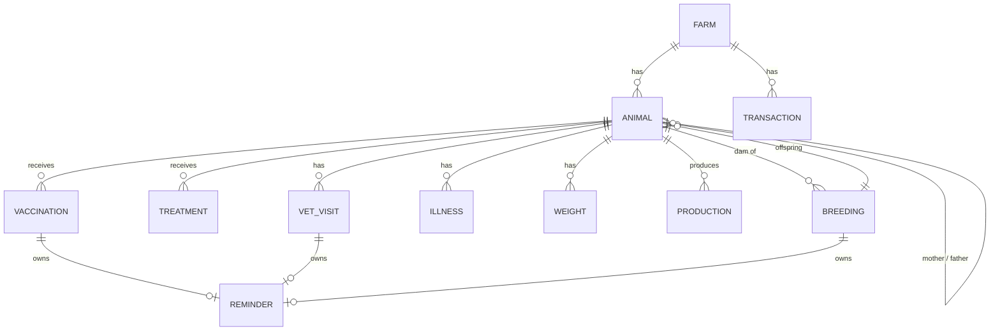

# Data model

## Storage layout
MongoDB database `farmivo`:
- **One collection per record type**, named after it: `farms`, `users`, `animals`, `vaccinations`, `treatments`, `vet_visits`, `illnesses`, `reminders`, `breedings`, `weights`, `production`, `feedings`, `transactions`, `notifications`, `devices`. Photos: GridFS `photos.files` / `photos.chunks`.
- `_id` is the record id. Every farm record carries `farm_id` (indexed); devices carry `user_id`.
- Look at the data in the shell: `use farmivo`, `show collections`, `db.animals.find().pretty()`, `db.vaccinations.find({farm_id: "<id>"})`. Your farm id: `db.users.find()` (one document per Firebase user, `_id` = Firebase UID).
- Internally the code still addresses records by Firestore-style paths (`farms/<farm_id>/animals`); the Mongo repository turns the last part into the collection name and the parent ids into fields, so the same code also runs on Firestore.
- GridFS bucket **`photos`**: animal photos (`photos.files`, `photos.chunks`) when `FARMIVO_PHOTO_STORE=gridfs` (default). With `minio`, photos are objects (random 32-hex names) in the bucket `farmivo-photos` instead, and nothing photo-related is stored in Mongo except `photo_url` on the animal.

All timestamps are ISO-8601 UTC strings (`created_at`, `updated_at`); dates are `YYYY-MM-DD` strings (sortable as text).

| Path | Contents |
|---|---|
| `farms/{farmId}` | name, currency, country, address, owner_uid, member_uids[] |
| `users/{uid}` | farm_id |
| `users/{uid}/devices/{id}` | token (FCM), platform (android/ios) |
| `farms/{farmId}/animals` | ear_tag (unique per farm), name, species, breed, sex, date_of_birth, date_added, origin, mother_id, father_id, notes, status, status_date, photo_url |
| `farms/{farmId}/vaccinations` | animal_id, vaccine_name, date_given, next_due_date, batch_number, administered_by, notes |
| `farms/{farmId}/treatments` | animal_id, name, medication, dosage, start_date, end_date, withdrawal_end_date, administered_by, notes |
| `farms/{farmId}/vet_visits` | animal_id, visit_date, vet_name, reason, diagnosis, notes, follow_up_date |
| `farms/{farmId}/illnesses` | animal_id, condition, start_date, recovery_date, symptoms, notes |
| `farms/{farmId}/breedings` | dam_id, sire_id, sire_note, mating_date, method, pregnancy_status, pregnancy_confirmed_date, expected_birth_date, actual_birth_date, offspring_ids[], notes |
| `farms/{farmId}/weights` | animal_id, date, weight_kg, notes |
| `farms/{farmId}/production` | animal_id (optional), date, product, quantity, unit, notes |
| `farms/{farmId}/feedings` | animal_id or group_name, date, feed_type, quantity_kg, notes |
| `farms/{farmId}/transactions` | type (income/expense), category, amount, date, description, animal_id |
| `farms/{farmId}/reminders` | source_type, source_id, animal_id, title, due_date, status, notified_buckets[] |
| `farms/{farmId}/notifications` | title, body, type, animal_id, reminder_id, read |

## Relations

Relations are by id (no database-enforced foreign keys); the API checks that referenced animals exist and have the right sex.

## Business rules
- **Ear tag** is unique within a farm (`409` otherwise).
- **Status:** `active`, `sick`, `quarantine` = on the farm; `sold`, `deceased` = left the farm. Changing to sold with a price creates an `animal_sale` income transaction; sold/deceased closes pending reminders.
- **Age** is computed at read time from `date_of_birth` (frozen at `status_date` for deceased animals). Never stored.
- **Parents:** `mother_id` must be a female animal, `father_id` a male animal; deleting an animal clears the link on its children.
- **Expected birth date** defaults from species gestation: cattle 283, sheep 147, goat 150, pig 114, horse 340, rabbit 31 days (`utils.py`). User-entered values win.
- **Recording a birth** creates one animal per offspring (species/breed of the dam, `origin=born_on_farm`, parents linked; stillborn → `deceased`), stores birth weights, marks the pregnancy `delivered`. A second birth on the same breeding is rejected (`409`).
- **Deleting an animal** deletes its health, weight, production, feeding, breeding (as dam) and reminder records.
- **Growth stats:** gain = last − first weight; average daily gain = gain ÷ days between them.
- **Finance:** `net = income − expenses`; summaries are per category and per month.
