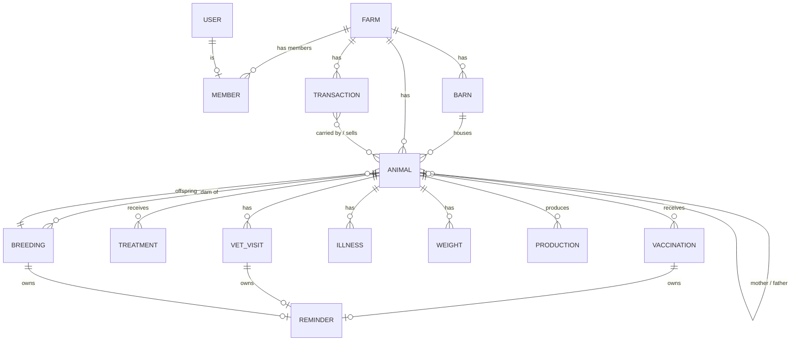

# Data model

## Storage layout
MongoDB database `farmivo`:
- **One collection per record type**, named after it: `farms`, `users`, `members`, `barns`, `animals`, `vaccinations`, `treatments`, `vet_visits`, `illnesses`, `reminders`, `breedings`, `weights`, `production`, `feedings`, `transactions`, `notifications`, `devices`. Photos: GridFS `photos.files` / `photos.chunks`.
- `_id` is the record id. Every farm record carries `farm_id` (indexed); devices carry `user_id`.
- Look at the data in the shell: `use farmivo`, `show collections`, `db.animals.find().pretty()`, `db.vaccinations.find({farm_id: "<id>"})`. Your farm id: `db.users.find()` (one document per Firebase user, `_id` = Firebase UID).
- Internally the code still addresses records by Firestore-style paths (`farms/<farm_id>/animals`); the Mongo repository turns the last part into the collection name and the parent ids into fields, so the same code also runs on Firestore.
- GridFS bucket **`photos`**: animal photos (`photos.files`, `photos.chunks`) when `FARMIVO_PHOTO_STORE=gridfs` (default). With `minio`, photos are objects (random 32-hex names) in the bucket `farmivo-photos` instead, and nothing photo-related is stored in Mongo except `photo_url` on the animal.

All timestamps are ISO-8601 UTC strings (`created_at`, `updated_at`); dates are `YYYY-MM-DD` strings (sortable as text).

| Path | Contents |
|---|---|
| `farms/{farmId}` | name, currency (3 letters; a farm created without one gets its country's, TND by default), country, address, owner_uid, invite_code (uppercase, unique, e.g. `GVF-7K3P`); old farms may still have member_uids[] (only read for legacy accounts) |
| `users/{uid}` | farm_id, status (`pending` / `active` / `rejected`, mirrors the member record), email_verified, lang (ar/fr/en of the last request). No `farm_id` = no farm |
| `farms/{farmId}/members/{uid}` | uid, email, name, role (`owner` / `manager` / `worker` / `viewer`), status (`pending` / `active` / `rejected`), requested_at, decided_at, decided_by |
| `users/{uid}/devices/{id}` | token (FCM), platform (android/ios), language (ar/fr/en: the language pushes to this phone use) |
| `farms/{farmId}/barns` | name (unique per farm), species / species_list (the species it takes; empty = any), capacity (places; more animals are allowed with a reminder), notes |
| `farms/{farmId}/animals` | farm_code (`01-0007/26`, given by the server), ear_tag (unique per species on the farm; empty → the farm code), name, species, breed, sex, color, date_of_birth or age_class (age by teeth), date_added, origin (`born_on_farm` / purchased), purchase_price, mother_id, father_id, barn_id, last_barn_id (the barn it left), notes, status, status_date, sale_price, buyer, sale_tx_id (its sale entry), recipient, status_notes, photo_url |
| `farms/{farmId}/vaccinations` | animal_id, vaccine_name, date_given, next_due_date, batch_number, administered_by, notes |
| `farms/{farmId}/treatments` | animal_id, name, medication, dosage, start_date, end_date, withdrawal_end_date, administered_by, notes |
| `farms/{farmId}/vet_visits` | animal_id, visit_date, vet_name, reason, diagnosis, notes, follow_up_date |
| `farms/{farmId}/illnesses` | animal_id, condition, start_date, recovery_date, symptoms, notes |
| `farms/{farmId}/breedings` | dam_id, sire_id, sire_note, mating_date, method, pregnancy_status (`expected` / `pregnant` / `not_pregnant` / `aborted` / `delivered`), pregnancy_confirmed_date, expected_birth_date, miscarriage_date, miscarriage_reason, actual_birth_date, offspring_ids[], notes |
| `farms/{farmId}/weights` | animal_id, date, weight_kg, notes |
| `farms/{farmId}/production` | animal_id (optional), date, product, quantity, unit, notes |
| `farms/{farmId}/feedings` | animal_id or group_name, date, feed_type, quantity_kg, notes |
| `farms/{farmId}/transactions` | type (income/expense), category, amount, date, description, barn_id, animal_ids[] (the animals that carry an expense or are sold; animal_id when one), whole_barn / whole_farm (shared by all the animals there when saved), weights[] (feed: share by age) |
| `farms/{farmId}/reminders` | source_type, source_id, animal_id, title (English), title_key + title_params (server-made reminders, rendered in the reader's language), due_date, status, notified_buckets[] |
| `farms/{farmId}/notifications` | title, body (English), title_key, body_key, params (rendered in the reader's language), type, animal_id, reminder_id, read |

## Email codes

`email_codes` (`_id` = Firebase uid): the current verification code of a new account, as a hash only.

| Field | Meaning |
|---|---|
| `email` | Where the code was sent |
| `code_hash` | HMAC-SHA256 of the code (key: `FARMIVO_CODE_SECRET` and the uid); `null` once burnt after 5 wrong tries |
| `expires_at` | 15 minutes after sending |
| `attempts` | Wrong tries so far |
| `last_sent_at`, `sent_at` | For the 60 s cooldown and the 5-per-hour limit |

The record is deleted when the code is confirmed; `users/{uid}.email_verified` (and `email_verified_at`) is then set and kept even when the user leaves a farm.

## Members and users

A person (Firebase uid) can belong to several farms (since 14 Nov 2026) and works in one at a time. Each membership is a record in `members` (Mongo `_id` = `<farm id>/<uid>`, older records `<uid>`; `farm_id` = the farm) with the role and the status of the request; `users/{uid}.farm_id` points at the farm in use so the server finds it in one read (`POST /me/farm` switches). Exactly one active member per farm has role `owner`, and `farms.owner_uid` names them. See [ROLES_AND_MEMBERS.md](ROLES_AND_MEMBERS.md).

```js
db.members.find({farm_id: "<farm id>"}).pretty()   // who is in a farm, with roles and pending requests
db.users.find({_id: "<firebase uid>"})              // which farm a person belongs to
db.farms.find({}, {name: 1, invite_code: 1, owner_uid: 1})
```

Older member records have the uid alone as `_id`; they are still read and get the `<farm id>/<uid>` id when written.

## Relations

Relations are by id (no database-enforced foreign keys); the API checks that referenced animals exist and have the right sex.

## Business rules
- **Farm number:** every animal gets `farm_code` `<species code>-<number>/<year>` (01 sheep, 02 cattle, 03 goat …; the year of birth on the farm, otherwise of arrival); it is the ear tag when none is typed. The ear tag is unique per species within a farm (`409` otherwise).
- **Status:** `active`, `sick`, `quarantine` = on the farm; `sold`, `deceased`, `donated`, `gifted`, `sacrificed` = left the farm (out of its barn, `last_barn_id` kept; pending reminders closed). Sold with a price books an `animal_sale` income; "active" undoes a mistake (back into its old barn).
- **Barns:** an animal goes only into a barn that takes its species; a barn over its capacity accepts it with a reminder (`notice`).
- **Age** is computed at read time from `date_of_birth` (frozen at `status_date` for animals that left), or shown from the age class. Never stored.
- **Parents:** `mother_id` must be a female, `father_id` a male, both of the animal's species and born before it; deleting an animal clears the link on its children.
- **Breeding rules** (`app/breeding_rules.py`): mating ages per species and sex, one pregnancy at a time, same species, pregnancy length window (sheep/goat up to 5 months 10 days, cattle up to 9 months 10 days, others from veterinary references), litter size, miscarriage seen today or up to 14 days ago. Expected birth date defaults from the gestation table (`utils.py`); user-entered values win.
- **Recording a birth** creates one animal per offspring (species/breed of the dam, `origin=born_on_farm`, parents linked; stillborn → `deceased`), stores birth weights, marks the pregnancy `delivered`. A second birth on the same breeding is rejected (`409`).
- **Deleting an animal** deletes its health, weight, production, feeding, breeding (as dam) and reminder records; finance entries keep their amounts (the animal is left out when an entry is edited).
- **Growth stats:** gain = last − first weight; average daily gain = gain ÷ days between them.
- **Finance:** every expense is carried by animals (chosen, a barn's or the farm's, equally; feed by age 0.5 / 1 / 1.5). Animals bought are capital (booked from the animal's purchase price; never typed). A sale entry naming several animals sells each at the average price (`app/sales.py`). Balance sheet and per-animal costs: `app/costs.py`. Lists are newest first.
