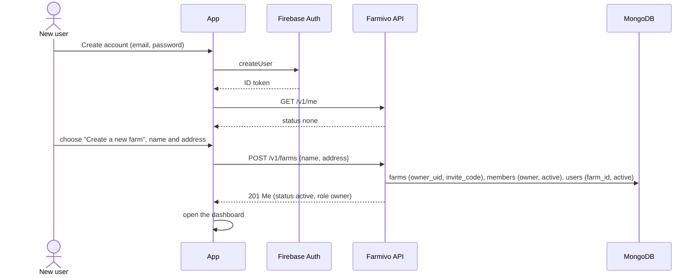
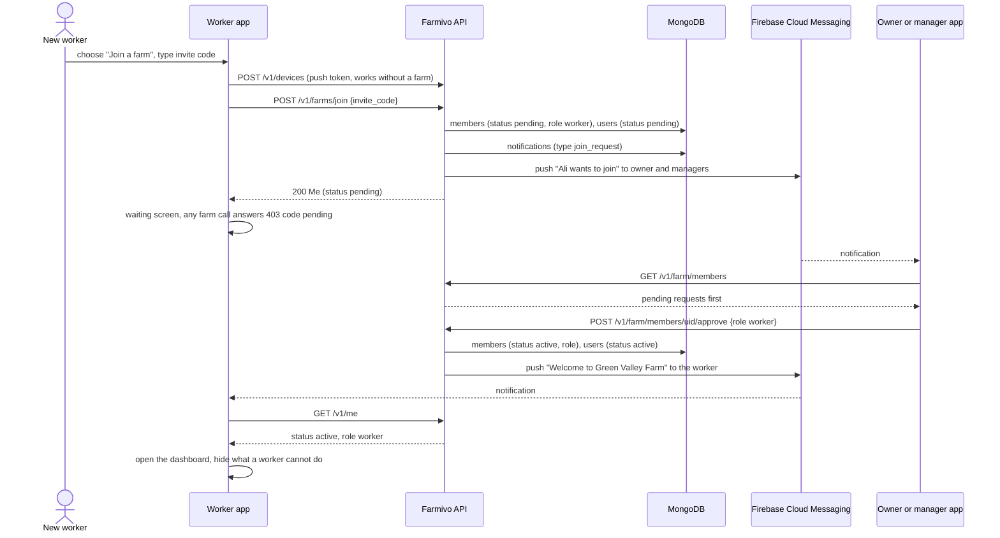

# Farm members and roles

Several people can work on the same farm. One person creates the farm and becomes its **owner**; everyone else **asks to join** with the farm's **invite code**, and the owner or a manager **approves** them with a role. The server enforces the roles on every request.

Code: `app/services/membership.py` (rules), `app/routers/members.py` (endpoints), `app/permissions.py` (who may call what), `app/deps.py` (`get_identity`, `get_ctx`). Endpoints and shapes: [API.md, Members & roles](API.md#members--roles).

## Concepts

| Term | Meaning |
|---|---|
| **Owner** | Created the farm (or received it by transfer). Exactly one per farm. Can do everything, including transferring ownership. Cannot leave or be removed while owner. |
| **Manager** | Everything except transferring ownership and changing or removing the owner: finance, deleting records, farm settings, approving and managing members, rotating the invite code. |
| **Worker** | Daily work: reads everything except finance; creates and edits animals, health, breeding, growth, production, feeding, reminders. Cannot delete records (except notifications), see finance, change farm settings or manage members. |
| **Viewer** | Read-only (for a vet or an advisor): reads everything except finance; can mark notifications read. |
| **Invite code** | Short code like `GVF-7K3P`: three letters from the farm name ("Green Valley Farm" gives `GVF`) and four random characters without look-alikes (no 0/O, 1/I/L). Managers and the owner see it in Farm settings and share it. Rotating it makes the old code stop working. A code alone gives no access: every request must be approved. |
| **Status** | Where a user stands, from `GET /me`: `none` (no farm), `pending` (asked to join, waiting), `active` (member with a role), `rejected` (request refused). |

A user belongs to **one farm at a time**. Asking to join another farm replaces a pending request; to switch farms an active member leaves first.

## Permission matrix

| Action | viewer | worker | manager | owner |
|---|:-:|:-:|:-:|:-:|
| Read animals, health, breeding, growth, production, feeding, reminders, notifications, dashboard (without finance), herd / vaccination / production reports, farm | ✓ | ✓ | ✓ | ✓ |
| Mark notifications read, read all | ✓ | ✓ | ✓ | ✓ |
| Create and edit records (POST / PATCH), upload photos, change animal status, record births, mark reminders done | | ✓ | ✓ | ✓ |
| Delete notifications | | ✓ | ✓ | ✓ |
| Delete records (animals, health, breeding, growth, production, feeding, reminders) | | | ✓ | ✓ |
| Finance: transactions, totals, financial report, dashboard `finance` | | | ✓ | ✓ |
| Farm settings (`PATCH /farm`), see the invite code | | | ✓ | ✓ |
| Members: list, approve, reject, change role (manager, worker, viewer), remove; rotate invite code | | | ✓ | ✓ |
| Change or remove the owner | | | | (transfer) |
| Transfer ownership | | | | ✓ |

How it is enforced: every farm endpoint calls `get_ctx()`, which loads the caller's membership and compares their role with `required_role(method, path)` in `app/permissions.py`:

| Rule (first match wins) | Lowest role |
|---|---|
| `/farm/transfer-ownership` | owner |
| `/transactions`, `/finance`, `/reports/financial`, `/farm/members`, `/farm/invite-code` | manager |
| any `GET` | viewer |
| `POST /notifications/{id}/read`, `POST /notifications/read-all` | viewer |
| other `/notifications` writes (delete) | worker |
| `PATCH /farm` | manager |
| any other `DELETE` | manager |
| any other `POST` / `PATCH` | worker |

A new route is therefore protected without extra code. The dashboard is readable by everyone; its `finance` section is `null` below manager.

## Flows

### Create a farm

### Join a farm and get approved

### Reject, leave, remove, transfer

- **Reject**: `POST /farm/members/{uid}/reject` gives `status: "rejected"` and a push. The person may ask again or create their own farm.
- **Leave / cancel**: `DELETE /me/membership`. The owner gets `409 "Transfer ownership first"`.
- **Remove**: `DELETE /farm/members/{uid}` (manager or owner, never the owner). The person's next request answers `403 no_farm`.
- **Transfer**: `POST /farm/transfer-ownership {uid}` (owner only, target must be active). The previous owner becomes a manager, `farms.owner_uid` changes.
- **Role change**: `PATCH /farm/members/{uid} {role}` takes effect on that person's next request (roles are read on every request).

## Errors

All `403` membership and role errors carry a `code`:

| Status, `code` | Meaning | App behaviour |
|---|---|---|
| `403 no_farm` | No farm (new, removed or left) | Show "Create a farm" / "Join a farm" |
| `403 pending` | Waiting for approval; `detail` names the farm | Waiting screen, "Cancel request", re-check `GET /me` on resume and on the approval push |
| `403 rejected` | Request refused | Explain, then "Create a farm" / "Join another farm" |
| `403 forbidden_role` | The role may not do this | Show `detail`; the UI should normally hide the action |
| `404 "No farm with this code"` | Wrong invite code | Inline error under the code field |
| `409` | Conflicts: already in a farm, owner leaving, changing the owner, approving a non-pending request | Show `detail` |

## What the apps do with `GET /me`

Call it after sign-in, on app start, when the app returns to the foreground, and when a `membership_approved` / `membership_rejected` push arrives.

| `status` | Screen |
|---|---|
| `none` | Choose: **Create a new farm** (name, address) or **Join a farm** (invite code) |
| `pending` | "Waiting for approval from {farm.name}" with **Cancel request** and **Sign out** |
| `rejected` | "Your request to join {farm.name} was not accepted" with **Create a farm** / **Join another farm** |
| `active` | The app; show or hide actions by `role` using the matrix above. More > **Members** for managers and the owner, invite code in Farm settings |

## Data

See [DATA_MODEL.md](DATA_MODEL.md#members-and-users).

- `members` (`farms/<farm_id>/members/<uid>`): `_id` = Firebase uid, `farm_id`, `uid`, `email`, `name`, `role`, `status` (`pending`, `active`, `rejected`), `requested_at`, `decided_at`, `decided_by`.
- `users` (`users/<uid>`): `_id` = uid, `farm_id`, `status`. No document means no farm.
- `farms`: `owner_uid`, `invite_code` (uppercase, unique).

Accounts created before memberships existed (a `users` document and a farm whose `owner_uid` is the user, no member record) become **active owners** on their first request, and their farm gets an invite code the first time a manager or owner opens it. Nothing has to be run on the server.
