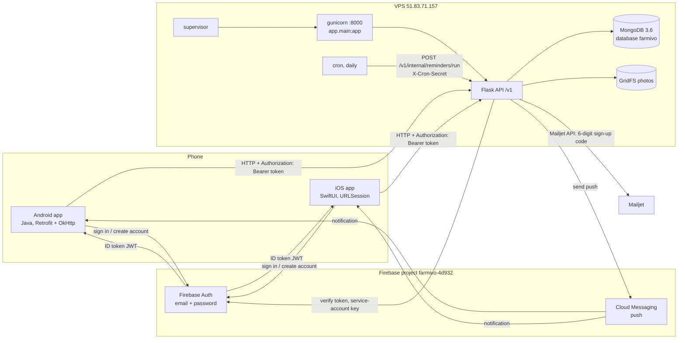
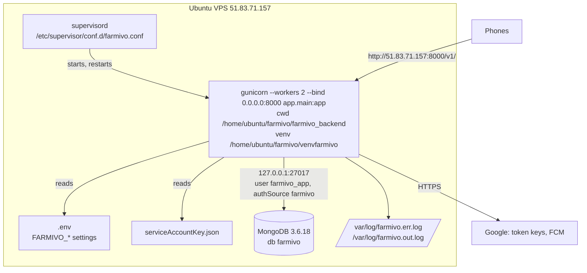
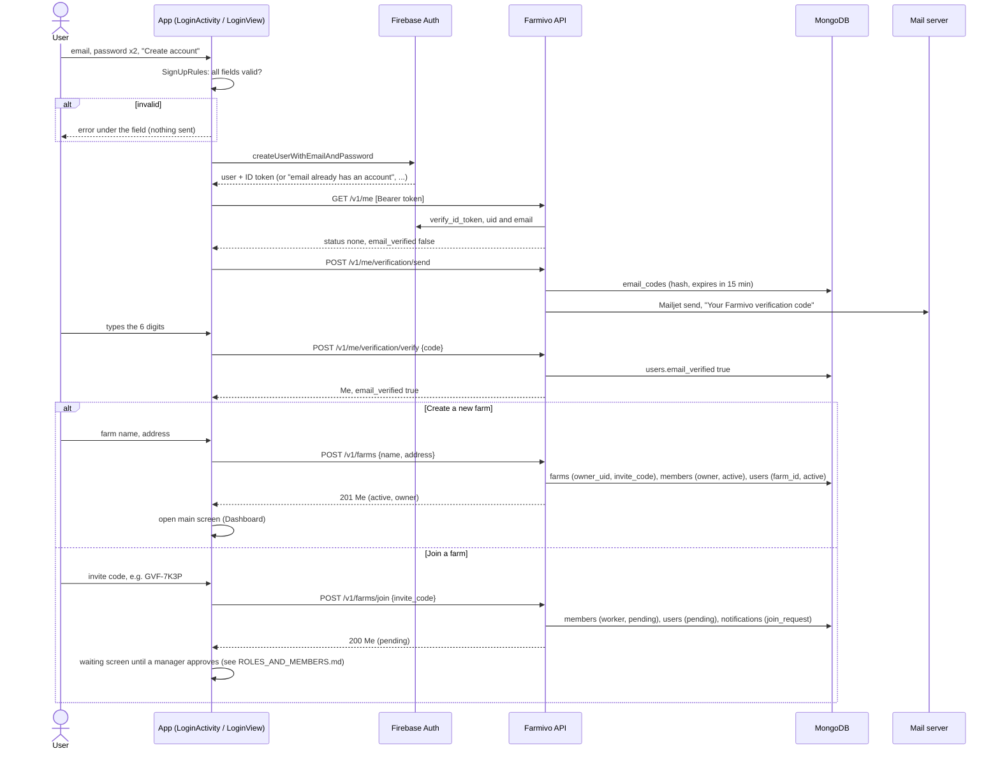
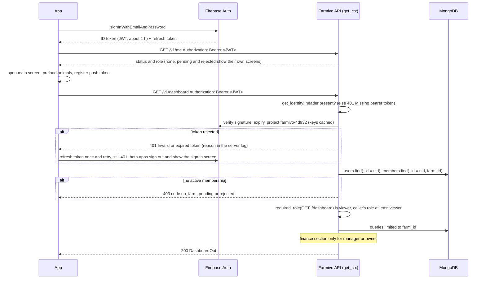
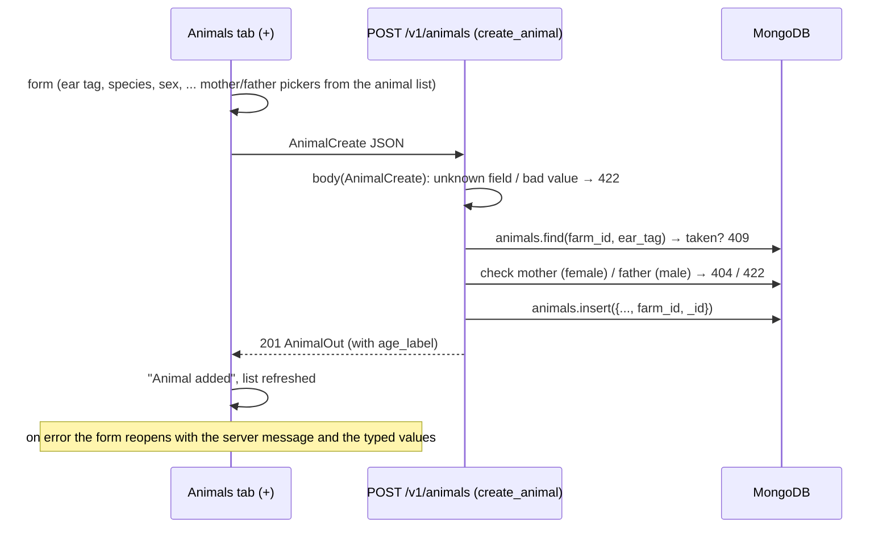
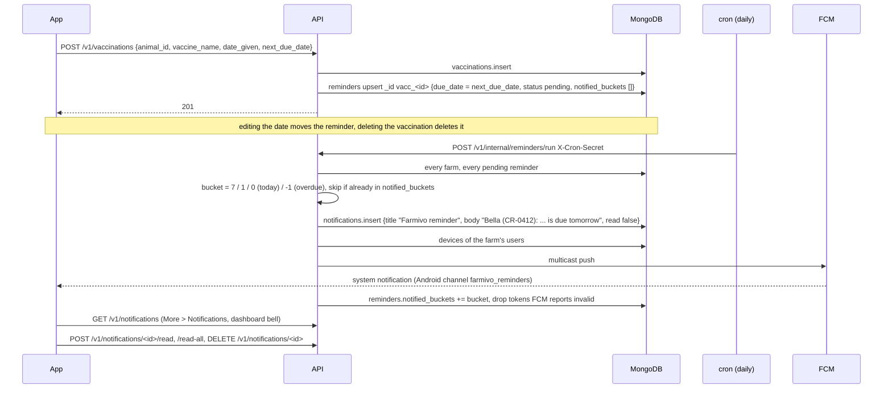
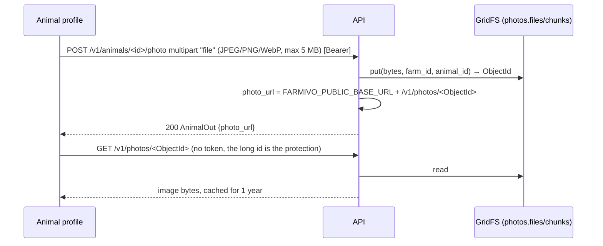
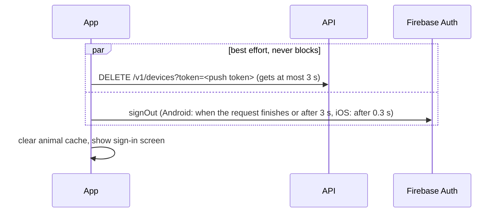
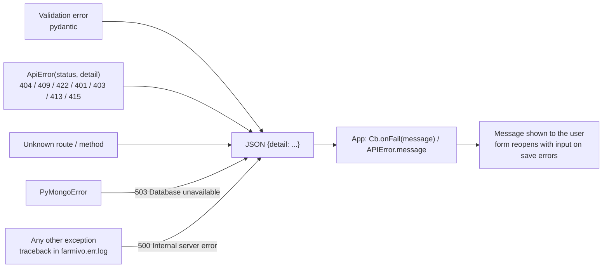

# System guide: how the three projects connect

Farmivo is three repositories that work as one system:

| Repository | Branch | What it is |
|---|---|---|
| [farmivo_backend](https://github.com/haythoum/farmivo_backend) | `feature/initial-api` | Python Flask API, served by gunicorn under supervisor, data in MongoDB |
| [farmivo_android](https://github.com/haythoum/farmivo_android) | `feature/initial-app` | Native Android app (Java), package `com.quadralens.farmivo` |
| [farmivo_ios](https://github.com/haythoum/farmivo_ios) | `feature/initial-app` | Native iOS app (SwiftUI), bundle id `com.quadralens.farmivo` |

Firebase project **`farmivo-4d932`** provides sign-in (Firebase Auth) and push delivery (Firebase Cloud Messaging). It stores no farm data. All farm data lives in MongoDB on the server.

Function-level detail of the backend is in [CODE_REFERENCE.md](CODE_REFERENCE.md), the endpoint contract in [API.md](API.md), and real request/response examples in [APP_FLOWS.md](APP_FLOWS.md).

---

## 1. Components

| Piece | Responsibility | Talks to |
|---|---|---|
| Android / iOS app | UI, input checks, keeps the Firebase session, calls the API with the ID token, shows pushes | Firebase Auth, Farmivo API, FCM |
| Firebase Auth | Accounts and passwords; issues ID tokens (JWT, valid for about 1 hour) | apps; the API verifies its tokens |
| Farmivo API | Validates and stores all farm data, keeps reminders, computes dashboards and reports, sends pushes | MongoDB, Firebase Auth (token check), FCM |
| MongoDB | One collection per record type (`animals`, `vaccinations`, …) plus GridFS photos | API |
| cron | Calls the reminder job once a day | API |
| Mailjet | Delivers the 6-digit email code after sign-up (`MAILJET_API_KEY` / `_SECRET`; without it the code goes to the server log) | API |

## 2. Deployment

| Item | Value on the current server |
|---|---|
| Code | `/home/ubuntu/farmivo/farmivo_backend`, branch `feature/initial-api` |
| Python | virtualenv `/home/ubuntu/farmivo/venvfarmivo` (Python 3.11) |
| Process | supervisor program `farmivo`, gunicorn, 2 workers, port 8000 on all interfaces |
| Settings | `/home/ubuntu/farmivo/farmivo_backend/.env` (template: `.env.example`) |
| Database | MongoDB 3.6.18 on the same machine. PyMongo is pinned below 4.11 because newer versions refuse 3.6. |
| Logs | `/var/log/farmivo.err.log` (the app's own log lines and tracebacks), `/var/log/farmivo.out.log` |
| Health check | `curl http://51.83.71.157:8000/healthz` → `{"status":"ok"}` |
| Full setup check | `/home/ubuntu/farmivo/venvfarmivo/bin/python -m scripts.check_setup` |

The API runs over plain HTTP on an IP address for now. The Android debug build and the iOS app explicitly allow that, and the Android release build refuses plain HTTP. For production, put the API behind a domain with HTTPS (`deploy/nginx/farmivo.conf`). Then point both apps at the `https://…/v1/` address and remove the iOS `NSAllowsArbitraryLoads` exception.

---

## 3. Sequences

### 3.1 Create account, then create or join a farm

### 3.2 Sign in and first API call

### 3.3 Add an animal

### 3.4 Vaccination, reminder, daily push and notification list

### 3.5 Photo upload and display

### 3.6 Sign out

---

## 4. Screens, endpoints, code and collections

Android: `farmivo_android/app/src/main/java/com/quadralens/farmivo/ui/`. iOS: `farmivo_ios/Farmivo/Features/`. Both apps use one generic list/form for record types, `RecordsFragment` + `FormDialog` and `RecordsListView` + `FormSheet`, configured by a registry (`Resources.java` / `Resources.swift`) that lists each type's path and fields.

| Screen | Android | iOS | API calls | Backend function(s) | Collections |
|---|---|---|---|---|---|
| Sign in / create account | `LoginActivity`, `util/SignUpRules` | `Auth/Views/LoginView`, `Core/Auth/AuthStore`, `SignUpRules` | Firebase Auth; `GET /me` | `me`, `get_identity`, `membership.resolve` | users, members |
| Create or join a farm, waiting screen | to be built | to be built | `POST /farms`, `POST /farms/join`, `DELETE /me/membership` | `create_farm`, `join_farm`, `leave_farm` | farms, members, users, notifications |
| Members (managers, owner) | to be built | to be built | `GET /farm/members`, `.../approve`, `.../reject`, `PATCH`/`DELETE /farm/members/<uid>`, `POST /farm/invite-code`, `POST /farm/transfer-ownership` | `list_members`, `approve_member`, `reject_member`, `change_member_role`, `remove_member`, `rotate_invite_code`, `transfer_ownership` | members, users, farms |
| Dashboard (tab 1) | `DashboardFragment` | `Dashboard/Views/DashboardView` | `GET /dashboard` | `dashboard`, `compute_finance` | animals, reminders, breedings, illnesses, transactions, notifications |
| Animals list (tab 2) | `AnimalsFragment` | `Animals/Views/AnimalsView` | `GET /animals?status=&q=` | `list_animals` | animals |
| Add / edit animal | `AnimalFormActivity` + `FormDialog` | `FormSheet` from `AnimalsView` / `AnimalDetailView` | `POST /animals`, `PATCH /animals/<id>` | `create_animal`, `update_animal`, `check_parents` | animals |
| Animal profile | `AnimalDetailActivity` → `AnimalProfileFragment` | `Animals/Views/AnimalDetailView` (Profile tab) | `GET /animals/<id>/family`, `POST /animals/<id>/status`, `POST /animals/<id>/photo`, `DELETE /animals/<id>` | `get_family`, `change_status`, `upload_photo`, `delete_animal` | animals, transactions (sale), reminders, GridFS |
| Animal → Health tab | `ResourceTabsFragment` (animal id) → `RecordsFragment` | `ResourceTabsView(ids: vaccinations, treatments, vet_visits, illnesses, animalId)` | `GET/POST/PATCH/DELETE /vaccinations, /treatments, /vet-visits, /illnesses ?animal_id=` | CRUD from `build_crud_blueprint`, `_sync_vaccination`, `_sync_vet_visit` | vaccinations, treatments, vet_visits, illnesses, reminders |
| Animal → Breeding tab | `ResourceTabsFragment(breedings)`, `BirthDialog` | `ResourceTabsView(ids: breedings)`, `Breeding/Views/BirthSheet` | `GET /breedings` (the app keeps rows where the animal is dam or sire), `POST /breedings/<id>/births` | breedings CRUD, `record_birth` | breedings, animals, weights, reminders |
| Animal → Growth tab | `GrowthFragment` (+ `GrowthChartView`) | `GrowthView` (in `AnimalDetailView.swift`) | `GET /animals/<id>/growth`, weights / production / feedings CRUD, `GET /production/summary` | `growth_chart`, `production_summary` | weights, production, feedings |
| Health (tab 3) | `ResourceTabsFragment` | `Health/Views/HealthView` | same as the animal Health tab, farm-wide | same | same |
| Breeding (tab 4) | `ResourceTabsFragment(breedings)` | `Breeding/Views/BreedingView` | breedings CRUD, births | same | same |
| More (tab 5) | `MoreFragment` | `More/Views/MoreView` | none (menu) | none | none |
| Growth & production | `HostActivity(GROWTH)` → `ResourceTabsFragment` | `ResourceTabsView(weights, production, feedings)` | weights / production / feedings CRUD, `/production/summary` | factory routes, `production_summary` | weights, production, feedings |
| Finance | `HostActivity(FINANCE)` → `FinanceFragment` | `Finance/Views/FinanceView` | `GET /finance/summary`, transactions CRUD | `finance_summary`, `compute_finance` | transactions |
| Reminders | `HostActivity(REMINDERS)` → `RecordsFragment(reminders)` | `ResourceTabsView(reminders)` | `GET/POST /reminders`, `POST /reminders/<id>/done`, `DELETE /reminders/<id>` | `list_reminders`, `create_custom_reminder`, `mark_reminder_done`, `delete_custom_reminder` | reminders |
| Notifications | `HostActivity(NOTIFICATIONS)` → `NotificationsFragment` | `Notifications/Views/NotificationsView` | `GET /notifications`, `/read`, `/read-all`, `DELETE` | notifications router | notifications |
| Reports | `HostActivity(REPORTS)` → `ReportsFragment` | `Reports/Views/ReportsView` | `GET /reports/<kind>?format=csv` → share sheet | `report`, `build_rows` | animals, vaccinations, transactions, production |
| Farm settings | `MoreFragment` (dialog) | `Settings/Views/FarmSettingsView` | `GET /farm` (role, invite code for managers), `PATCH /farm` (manager or owner) | `get_farm`, `update_farm`, `render_farm` | farms |
| Sign out | `MoreFragment` → `fcm/DeviceRegistrar.unregisterAndSignOut` | `AuthStore.signOut` → `PushManager.unregisterDevice` | `DELETE /devices?token=` | `unregister_device` | devices |
| Push registration | `fcm/DeviceRegistrar`, `fcm/FarmivoMessagingService` | `Core/Push/PushManager` | `POST /devices` | `register_device` | devices |

Supporting app classes:

| Purpose | Android | iOS |
|---|---|---|
| HTTP client, base URL, token header, 401 retry | `data/ApiClient` (OkHttp interceptor + authenticator), `data/Api` (generic Retrofit calls), `data/Cb` (callback → `onOk` / `onFail(message)`) | `Core/Networking/APIClient` |
| Animal cache for pickers and labels | `data/Animals` | `Core/Utilities/AnimalStore` |
| Record type registry | `ui/Resources`, `ui/Resource`, `ui/Field` | `Shared/Views/Resources.swift` |
| Generic list + form | `ui/RecordsFragment`, `ui/RowAdapter`, `ui/FormDialog` | `Shared/Views/RecordsListView`, `FormSheet`, `FormField` |
| Look and feel | `res/values/colors.xml`, `themes.xml`, `ui/UiKit` | `Shared/Views/Theme.swift`, `Cards.swift`, asset catalog |
| JSON helpers and formatting | `util/J`, `util/Fmt` | `Core/Models/JSONValue`, `Core/Utilities/Fmt` |

---

## 5. Configuration matrix

| Setting | Backend | Android | iOS |
|---|---|---|---|
| API address | `FARMIVO_PUBLIC_BASE_URL` in `.env` (photo links) | `farmivoApiUrl` in `gradle.properties` → `BuildConfig.API_BASE_URL`; `/v1/` is appended if missing | `API_BASE_URL` in `Config/Debug.xcconfig` / `Release.xcconfig` → Info.plist `FarmivoAPIBaseURL`; `/v1/` appended if missing |
| Plain HTTP allowed | n/a | debug only: `app/src/debug/res/xml/network_security_config.xml` | `NSAllowsArbitraryLoads` in `project.yml` (remove once HTTPS) |
| Firebase client config | n/a | `app/google-services.json` (project `farmivo-4d932`) | `Farmivo/Resources/GoogleService-Info.plist` |
| Firebase project id | `FARMIVO_FIREBASE_PROJECT_ID=farmivo-4d932` | inside `google-services.json` | inside `GoogleService-Info.plist` |
| Firebase server key (secret) | `serviceAccountKey.json`, path in `FARMIVO_FIREBASE_CREDENTIALS`; never in git | none | none |
| iOS push | n/a | n/a | APNs key uploaded in the Firebase console |
| MongoDB | `FARMIVO_MONGO_HOST`, `_PORT`, `_USER`, `_PASSWORD`, `_AUTH_DB`, `_DB`, `_PREFIX` (or `FARMIVO_MONGO_URI`) | none | none |
| Photo storage | `FARMIVO_PHOTO_STORE=gridfs` (or `minio` + `FARMIVO_MINIO_*`) | none | none |
| Reminder job | `FARMIVO_CRON_SECRET` + a daily crontab line calling `/v1/internal/reminders/run` | none | none |
| Sign-up email code | `MAILJET_API_KEY`, `MAILJET_API_SECRET`, `FARMIVO_MAIL_FROM_EMAIL`, `FARMIVO_MAIL_FROM_NAME`; `FARMIVO_CODE_SECRET` (empty key: code in the server log) | none | none |
| Process | `/etc/supervisor/conf.d/farmivo.conf` (template `deploy/supervisor/farmivo.conf`) | none | none |
| App id | none | `applicationId com.quadralens.farmivo` | bundle id `com.quadralens.farmivo` |

---

## 6. Error handling chain

- **Server:** `app/errors.py` turns every error into `{"detail": ...}`. `detail` is text, or for 422 a list of `{loc, msg, type}`. Membership and role errors are `403` with an extra `code` (`no_farm`, `pending`, `rejected`, `forbidden_role`) for the apps to route on.
- **Android:** `data/Cb.errorMessage` reads `detail`. For a list, it shows the first `msg` plus its location. For a 404 it adds the URL that was called. A network failure becomes "No connection. Check your network and try again."
- **iOS:** `APIClient` produces `APIError(status, message)` from `detail` and shows it in an alert or inline. A repeated 401 posts `farmivoSessionExpired`, and the app signs out.
- **401:** both apps refresh the Firebase token once and retry (Android: OkHttp `RefreshAuthenticator`; iOS: `APIClient`). If it still fails, both apps sign the user out and return to the sign-in screen (Android: `Cb` calls `FarmivoApp.sessionExpired()`).

## 7. Security model

- **Identity:** the apps never send passwords to the API, only to Firebase. Every API call carries a Firebase ID token. The API checks its signature (Google's public keys), expiry and project (`farmivo-4d932`), then takes the `uid` from it.
- **Farm scoping:** the farm comes from the caller's active membership (`users/<uid>.farm_id` plus an active record in `members`), never from the URL or the body. Every repository query includes that `farm_id`, so one user cannot read or change another farm's data even with a guessed record id. Joining needs an invite code **and** approval by a manager or the owner.
- **Roles:** owner, manager, worker, viewer. `get_ctx` checks the caller's role against `required_role(method, path)` (`app/permissions.py`) on every request; finance, deletes, farm settings and members are for managers and the owner. Role changes and removals take effect on the next request. Details: [ROLES_AND_MEMBERS.md](ROLES_AND_MEMBERS.md).
- **Validation:** request bodies reject unknown fields and bad values (422); cross-record rules are checked server-side (parents' sex, unique ear tags, birth dates).
- **Public endpoints:** `/healthz` and `/v1/photos/<id>`, which needs a random, unguessable id. `/v1/internal/reminders/run` needs `X-Cron-Secret`.
- **Secrets:** `.env`, `serviceAccountKey.json` and the database passwords stay on the server, git-ignored and `chmod 600`. The Firebase client files in the apps are not secrets.
- **Not yet in place:** HTTPS, rate limiting and an audit log. Turn on HTTPS before real users.

## 8. Glossary

| Term | Meaning |
|---|---|
| ID token / JWT | Signed token from Firebase Auth proving who the user is; sent as `Authorization: Bearer <token>`; valid for about 1 hour, refreshed by the app. |
| UID | Firebase user id (28 characters). Also the `_id` of the user's record in `users`. |
| Farm | One per user. Created on the user's first API call; all records belong to it via `farm_id`. |
| Ctx | Backend request context of an active member: uid, farm id, role, farm, repository (`app/deps.py`). |
| Identity | The caller from the token: uid, email, name (`get_identity`), used before a farm exists. |
| Member / role | A person's record in a farm (`members`): owner, manager, worker or viewer; status pending, active or rejected. |
| Invite code | Code like `GVF-7K3P` that people type to ask to join a farm. |
| Repository | Backend storage interface; MongoDB in production (`app/repository.py`). |
| Path | Internal record address such as `farms/<farm_id>/animals`; with MongoDB, the last part is the collection. |
| Reminder bucket | When a reminder is pushed: 7 days before, 1 day before, on the day, overdue. Each only once. |
| Source record | The vaccination, vet visit or breeding that owns a reminder (`vacc_`, `vet_`, `birth_` ids). |
| On farm | Status active, sick or quarantine (not sold or deceased). |
| Dam / sire | Mother / father in a breeding record. |
| FCM token | Device address for push; registered with `POST /v1/devices`. |
| GridFS | MongoDB's file storage, used for animal photos. |
| supervisor | Process manager that keeps gunicorn running on the server. |
